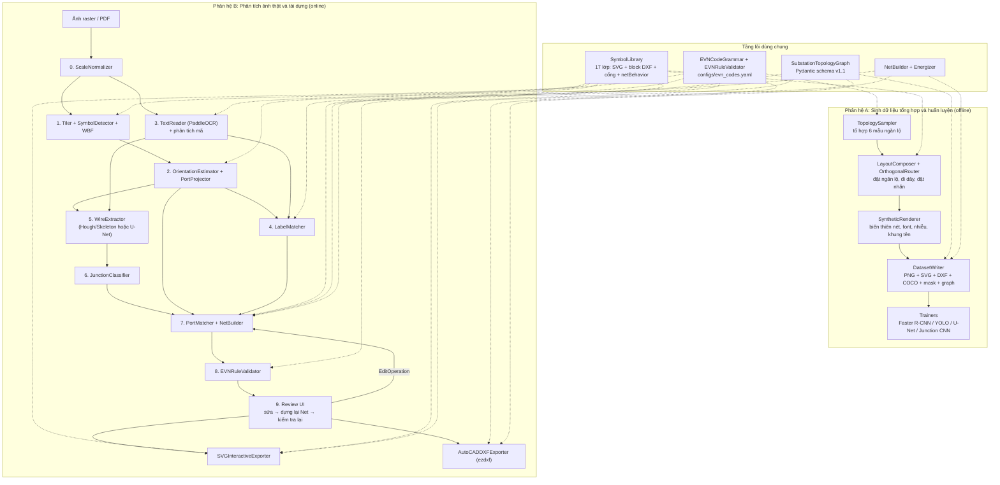

# Tài Liệu Thiết Kế Hệ Thống (Software Design Document – SDD)
## Dự Án: Phân Tích, Khôi Phục Đồ Thị và Tái Dựng Bản Vẽ Sơ Đồ Nhất Thứ Trạm Biến Áp (SVG & AutoCAD)

> **Phiên bản:** 1.2  
> **Ngày cập nhật:** 29/10/2026  
> **Tài liệu liên kết:** [bao_cao_dinh_huong_phat_trien_san_pham.md](bao_cao_dinh_huong_phat_trien_san_pham.md), [ke_hoach_thuc_hien.md](ke_hoach_thuc_hien.md), [sample_output.json](output/latex/sample_output.json), [tong_hop_cac_doan_chat.md](tong_hop_cac_doan_chat.md)  
> **Bản trước:** [tmp/thiet_ke_he_thong_sdd_v1.0.md](tmp/thiet_ke_he_thong_sdd_v1.0.md) (v1.1 xem lịch sử git)

### Lịch sử thay đổi

| Phiên bản | Ngày | Nội dung |
|---|---|---|
| 1.0 | 26/10/2026 | Bản đầu tiên. |
| 1.1 | 29/10/2026 | Chốt danh mục 17 lớp ký hiệu và thuộc tính `netBehavior` / `conduction` (bỏ `conductsWhenClosed`). Thêm mục Quy ước chung (tọa độ, góc, lật hình, đơn vị mm cho DXF). Sửa schema đồ thị: tham chiếu có kiểu, `nets` là nguồn chuẩn duy nhất của quan hệ đấu nối, thêm `bays`, `texts`, `provenance`; bỏ `branchPairs` và nút `bend`. Sửa sơ đồ phụ thuộc pipeline. Thêm interface giữa các khâu, bước chuẩn hóa tỉ lệ, ước lượng hướng ký hiệu. Sửa hàm chi phí ghép cổng và ghép nhãn (cho phép không ghép, ràng buộc cứng). Viết lại luật mã EVN thành ngữ pháp cấu hình được. Thêm thiết kế bộ đi dây của bộ sinh, bộ xuất SVG, giao diện duyệt, thuật toán tô vùng mang điện, so khớp đồ thị khi đánh giá, tiêu chí nghiệm thu có số liệu và yêu cầu phi chức năng. |
| 1.2 | 29/10/2026 | Viết lại ngữ pháp mã EVN theo Thông tư 44/2014/TT-BCT, Chương IV (bảng cấp áp đầy đủ, chữ số loại ngăn của máy cắt, hậu tố dao tiếp địa sinh theo luật); đóng câu hỏi mở 13.1–13.2. Ghi nhận dữ liệu thật là PDF vector khổ A4: `pxPerMm` theo trang thật, danh mục trang `configs/raw_pages.yaml`, kích thước bitmap thực tế khi xoay trang. Thêm Mục 8.6 (nguồn nhãn vector cho bản vẽ thật) và các script Giai đoạn 0. |

---

## 1. Giới Thiệu & Mục Đích Tài Liệu

Tài liệu này quy định kiến trúc phần mềm, quy ước dữ liệu, định dạng giao tiếp (JSON Schema), interface giữa các mô-đun, thuật toán xử lý và tiêu chí nghiệm thu cho hệ thống **Phân tích và Số hóa Sơ đồ Nhất thứ Trạm biến áp theo quy ước đánh số của EVN**.

Phạm vi: sơ đồ nhất thứ toàn trạm (Loại A trong báo cáo định hướng), đầu vào là ảnh raster hoặc PDF được raster hóa. Ngoài phạm vi: sơ đồ lưới phân phối (Loại B), tính toán dòng/công suất.

### 1.1. Các nguyên tắc thiết kế cốt lõi (Design Principles)
1. **Một biểu diễn trung gian duy nhất (IR):** Mọi mô-đun nhận dạng và bộ sinh dữ liệu đều hội tụ về `SubstationTopologyGraph` (JSON). Từ IR này mới xuất ra `SVG`, `DXF` hoặc hiển thị lên UI. Đáp án của dữ liệu tổng hợp và đầu ra của pipeline dùng cùng một schema.
2. **Một nguồn chuẩn cho mỗi loại thông tin (Single Source of Truth):**
   - Danh mục lớp ký hiệu, cổng, hành vi điện: chỉ khai báo trong `assets/symbols_metadata.json` (Mục 5). Mã nguồn không liệt kê cứng tên lớp.
   - Quan hệ đấu nối thiết bị–cổng–net: chỉ lưu trong mảng `nets` của đồ thị. Các đối tượng khác không lưu `netId`.
   - Quy tắc mã vận hành EVN: chỉ khai báo trong `configs/evn_codes.yaml`.
3. **Thiết kế cắm-và-chạy (Pluggable Pipeline):** Mỗi khâu có một interface (Mục 7). Thuật toán cổ điển (`Morphology + Hough`) và mô hình học sâu (`U-Net`, `Faster R-CNN`, `YOLO`) cài đặt cùng interface, chọn qua file cấu hình, để chạy thực nghiệm đối chứng.
4. **Không suy đoán mù (Explicit Uncertainty):** Kết nối, điểm giao hoặc nhãn có độ tin cậy dưới ngưỡng được gán `reviewStatus: "pending"` và sinh một `issue`. Luật EVN chỉ được dùng để **chọn giữa các ứng viên đã có** hoặc **đánh dấu mâu thuẫn**, không được tự tạo kết nối không có bằng chứng hình ảnh.
5. **Kiểm chứng được từng tầng:** Mỗi tầng có bộ kiểm thử và chỉ số riêng (Mục 9–10). Lát cắt đầu tiên cần chạy được là chuỗi xác định: *bộ sinh → đồ thị đáp án → xuất SVG/DXF → đọc lại và kiểm tra*, trước khi có mô hình học máy.

---

## 2. Quy Ước Chung (Conventions)

Mọi mô-đun phải tuân theo các quy ước dưới đây. Sai lệch quy ước là nguồn lỗi chính khi ghép SVG, ảnh và AutoCAD.

### 2.1. Hệ tọa độ và đơn vị

| Hệ | Gốc | Trục Y | Đơn vị | Dùng ở |
|---|---|---|---|---|
| **Ảnh / trang** | Góc trên-trái | Hướng xuống | px (sau chuẩn hóa tỉ lệ, Mục 8.2.1) | Toàn bộ đồ thị JSON, SVG, COCO |
| **Cục bộ ký hiệu** | Tâm hình học ký hiệu | Hướng xuống (như SVG) | Đơn vị thư viện (`lu`) | `symbols_metadata.json`, file SVG ký hiệu |
| **Block DXF** | Tâm hình học ký hiệu | **Hướng lên** | mm | `assets/symbols.dxf` |
| **Bản vẽ CAD** | Góc dưới-trái của trang | Hướng lên | mm | File `.dxf` xuất ra |

- `page.pxPerMm`: số pixel trên 1 mm giấy của trang đã chuẩn hóa. Lấy từ **kích thước trang PDF thật** khi raster hóa, không giả định khổ giấy. Bản vẽ thật hiện có (E18.9) là **A4**, bản vẽ ngang đặt trên trang dọc. Với ảnh scan không rõ khổ giấy, ước lượng từ độ dày nét chuẩn (Mục 8.2.1) và đánh dấu `page.pxPerMmSource: "estimated"`.
- **Xoay trang khi raster hóa:** góc xoay thêm (theo chiều kim đồng hồ) khai báo cho từng trang trong `configs/raw_pages.yaml`. Phép đổi điểm PDF (point) → ảnh (px) nằm ở `src/core/page_transform.py`, dùng chung cho ảnh raster và nhãn vector. Khi xoay phải dùng **kích thước bitmap thực tế** do trình render trả về (`renderSizePx`), vì pdfium có thể làm tròn lên 1 px.
- `symbols_metadata.libraryUnitMm`: kích thước 1 `lu` trên giấy (mm).
- **Tỉ lệ dự kiến** của một ký hiệu trên trang: $s_{\text{exp}} = \text{pxPerMm} \times \text{libraryUnitMm}$ (px/lu).

### 2.2. Hộp bao, góc xoay và lật hình
- **`bbox`** luôn là `[x, y, w, h]`: góc trên-trái và kích thước, đơn vị px, trục song song trục ảnh.
- **`transform`** của thiết bị: `{x, y}` là tâm ký hiệu (px), `rotationDeg` $\theta \in \{0, 90, 180, 270\}$, `mirrorX` (lật theo trục X cục bộ **trước** khi xoay), `scale` (px/lu).
- **Chiều góc:** dùng ma trận xoay chuẩn trong hệ ảnh (Y hướng xuống), nên $\theta$ dương là **quay theo chiều kim đồng hồ** khi nhìn trên màn hình. Thuộc tính `transform="rotate(θ)"` của SVG cũng theo đúng quy ước này.
- **Phép chiếu cổng từ cục bộ ra trang:**

$$
\mathbf{X}_k = \mathbf{c} + s \cdot R(\theta)\, M\, \mathbf{u}_k,\qquad
R(\theta)=\begin{bmatrix}\cos\theta & -\sin\theta\\ \sin\theta & \cos\theta\end{bmatrix},\quad
M=\begin{bmatrix}m & 0\\ 0 & 1\end{bmatrix},\; m = \begin{cases}-1 & \text{nếu mirrorX}\\ 1 & \text{ngược lại}\end{cases}
$$

  với $\mathbf{c}$ là tâm, $\mathbf{u}_k = (u_k, v_k)$ là tọa độ cục bộ của cổng $k$. Hướng ra của cổng biến đổi tương tự nhưng không nhân $s$.

### 2.3. Quy đổi sang AutoCAD (lật trục Y)
Gọi $F = \mathrm{diag}(1, -1)$ và $H$ là chiều cao trang (px). Vì $F R(\theta) = R(-\theta) F$ và $F$ giao hoán với $M$:

$$
\mathbf{X}^{\text{CAD}} = \frac{1}{\text{pxPerMm}}\left(F\mathbf{X} + \begin{bmatrix}0\\H\end{bmatrix}\right)
= \mathbf{c}^{\text{CAD}} + \frac{s}{\text{pxPerMm}}\, R(-\theta)\, M\, (F\mathbf{u}_k)
$$

Hệ quả bắt buộc:
1. **Block DXF được vẽ ở hệ Y hướng lên:** cổng $k$ của block nằm tại $(u_k, -v_k) \times \text{libraryUnitMm}$ (mm). Nếu dựng block bằng cách chép nguyên hình SVG (Y hướng xuống) thì các ký hiệu bất đối xứng (dao tiếp địa, trung tính MBA, mũi tên) sẽ bị soi gương trong AutoCAD.
2. `INSERT`: điểm chèn $\mathbf{c}^{\text{CAD}}$, `rotation` $= (-\theta) \bmod 360$, `xscale` $= m \cdot k$, `yscale` $= k$, với $k = s / s_{\text{exp}}$ (thường $\approx 1$).
3. Có unit test so tọa độ cổng chiếu qua SVG và qua `INSERT` của DXF cho **mọi lớp × mọi góc × có/không lật** (Mục 10).

### 2.4. Tham chiếu có kiểu (Typed Reference)
Mọi liên kết giữa các đối tượng dùng một dạng chung, không trộn ID của các loại khác nhau trong cùng một mảng:

```json
{"kind": "device",  "id": "dev-171"}
{"kind": "port",    "deviceId": "dev-171", "portId": "p2"}
{"kind": "wire",    "id": "wire-013"}
{"kind": "busbar",  "id": "bus-C11"}
{"kind": "node",    "id": "node-j01"}
{"kind": "text",    "id": "txt-0041"}
{"kind": "bay",     "id": "bay-171"}
```

### 2.5. Trạng thái
- `reviewStatus`: `pending` → `confirmed` | `rejected` | `edited` (chỉ UI hoặc bộ sinh được đặt `confirmed` / `edited`; pipeline đặt `confirmed` khi vượt ngưỡng tin cậy).
- `connectionStatus` (dây–cổng): `confirmed` | `candidate` | `dangling`.
- `drawingState` (trạng thái vẽ trên bản vẽ) và `operationalState` (trạng thái vận hành do người dùng đặt): `open` | `closed` | `unknown`. Pipeline chỉ suy ra `drawingState`; `operationalState` mặc định bằng `drawingState`.

---

## 3. Kiến Trúc Tổng Thể Hệ Thống (System Architecture)

Hệ thống gồm **2 phân hệ** dùng chung tầng lõi: **Danh mục ký hiệu (`SymbolLibrary`)**, **Schema đồ thị (`SubstationTopologyGraph`)**, **Ngữ pháp mã EVN (`EVNCodeGrammar`)**, **Bộ dựng Net (`NetBuilder`)** và **Bộ xuất (`Exporters`)**.



**Thứ tự phụ thuộc của Phân hệ B** (chỉ các bước cùng mức mới chạy song song):

| Mức | Bước | Cần kết quả của |
|---|---|---|
| 0 | `ScaleNormalizer` | Ảnh gốc |
| 1 | `SymbolDetector` ‖ `TextReader` | Mức 0 |
| 2 | `OrientationEstimator` + `PortProjector` | Detector |
| 3 | `LabelMatcher` ‖ `WireExtractor` | Mức 2 + `TextReader` (dây cần che vùng ký hiệu và chữ) |
| 4 | `JunctionClassifier` | `WireExtractor` |
| 5 | `PortMatcher` → `NetBuilder` → `EVNRuleValidator` | Mức 2–4 |
| 6 | Review UI ⇄ (`PortMatcher`/`NetBuilder`/`Validator`) | Mức 5 |
| 7 | Exporters | Đồ thị đã duyệt |

Bộ sinh dữ liệu (Phân hệ A) dùng lại `NetBuilder` để tính `nets` của đáp án, nhờ đó định nghĩa Net của đáp án và của pipeline luôn giống nhau.

---

## 4. Cấu Trúc Thư Mục Mã Nguồn (Project Directory Structure)

```text
Phan tich so do mach dien/
├── assets/
│   ├── symbols_svg/                 # 17 file SVG ký hiệu (1 file / lớp detector), hệ Y xuống
│   ├── symbols.dxf                  # 1 file chứa đủ 17 block (hệ Y lên, đơn vị mm, có ATTDEF)
│   └── symbols_metadata.json        # Nguồn chuẩn: lớp, kích thước, cổng, netBehavior, hướng
├── configs/
│   ├── generator_config.yaml        # Số mẫu, phân bố độ khó, seed, tham số biến thiên & nhiễu
│   ├── layout_presets.yaml          # Bố cục vùng cấp điện áp (110 trên, 22 dưới, 35 dọc phải...)
│   ├── inference_config.yaml        # Chọn cài đặt cho từng interface + mọi ngưỡng τ
│   ├── evn_codes.yaml               # Ngữ pháp mã vận hành, bảng cấp điện áp, bảng hậu tố
│   ├── cad_layers.yaml              # Tên layer, màu, độ dày nét, font (cấu hình được)
│   └── raw_pages.yaml               # Danh mục trang bản vẽ gốc: file, trang, loại A/B, góc xoay, pxPerMm
├── data/                            # Không đưa vào git (bản vẽ nội bộ)
│   ├── raw_pdfs/                    # PDF gốc: typeA/ (sơ đồ nhất thứ trạm), typeB/ (lưới, phiếu thao tác)
│   ├── raw_images/                  # Ảnh không có PDF gốc (E18.1 độ phân giải thấp)
│   ├── processed/<id>/              # page.png, page_meta.json, vector.json, overlay.png (Mục 8.6)
│   ├── synthetic/                   # Mỗi lần sinh 1 thư mục con có ghi seed + version
│   │   └── v001_n100/
│   │       ├── images/ svg/ dxf/ masks/ graphs/
│   │       ├── annotations_coco.json
│   │       ├── split.json           # Chia train/val theo topology gốc
│   │       └── manifest.json        # seed, git hash, generator_config đã dùng
│   └── real_gold/
│       ├── dev/                     # Bản vẽ dùng để chỉnh tham số (gồm E18.1)
│       └── test/                    # Bản vẽ giữ riêng, chỉ chạy khi chốt kết quả
├── src/
│   ├── core/
│   │   ├── schema.py                # Pydantic models v1.1 + kiểm tra bất biến (Mục 6.3)
│   │   ├── types.py                 # Kiểu dữ liệu trung gian (Mục 7.1)
│   │   ├── interfaces.py            # Protocol cho các khâu (Mục 7.2)
│   │   ├── registry.py              # Ánh xạ tên trong inference_config → cài đặt
│   │   ├── geometry.py              # Phép chiếu cổng, quy đổi CAD (Mục 2.2–2.3)
│   │   ├── page_transform.py        # Đổi tọa độ trang PDF → ảnh đã xoay (Mục 2.1)
│   │   ├── raw_pages.py             # Đọc configs/raw_pages.yaml
│   │   ├── symbol_lib.py            # Đọc symbols_metadata, PortProjector
│   │   ├── evn_codes.py             # EVNCodeGrammar: chuẩn hóa + phân tích mã
│   │   └── net_builder.py           # NetBuilder + Energizer (dùng chung A và B)
│   ├── generator/
│   │   ├── bay_templates.py         # 6 mẫu ngăn lộ dựng trong hệ chuẩn
│   │   ├── topology_sampler.py      # Sinh cấu trúc trạm + mã thiết bị
│   │   ├── layout_composer.py       # Đặt thanh cái, ngăn lộ, nhãn; kiểm tra chồng hình
│   │   ├── router.py                # Đi dây trực giao giữa các ngăn lộ (A*)
│   │   ├── renderer.py              # SVG → PNG, biến thiên và nhiễu, vật gây nhiễu
│   │   └── dataset_writer.py        # Xuất PNG, SVG, DXF, mask, COCO, graph
│   ├── perception/
│   │   ├── scale_normalizer.py      # Ước lượng độ dày nét, đưa về tỉ lệ chuẩn
│   │   ├── tiler.py                 # Cắt patch có overlap, gộp box bằng WBF
│   │   ├── symbol_detector.py       # Faster R-CNN / YOLOv8 (cùng interface)
│   │   ├── orientation.py           # Ước lượng θ và mirrorX bằng so khớp mẫu
│   │   ├── ocr_engine.py            # PaddleOCR + xử lý chữ dọc
│   │   ├── label_matcher.py         # Ghép nhãn Hungarian có lựa chọn "không ghép"
│   │   ├── wire_classical.py        # Morphology + HoughLinesP + Skeleton tracing
│   │   ├── wire_unet.py             # U-Net + skeleton tracing
│   │   ├── busbar_classifier.py     # Tách thanh cái khỏi dây
│   │   └── junction_classifier.py   # Luật hình học hoặc CNN 4 lớp
│   ├── reconstruction/
│   │   ├── port_matcher.py          # Ghép đầu mút dây vào cổng (gán toàn cục)
│   │   ├── assembler.py             # Lắp đồ thị từ các kết quả trung gian
│   │   └── graph_validator.py       # Luật EVN + bất biến → issues
│   ├── exporters/
│   │   ├── svg_exporter.py          # SVG tương tác (Mục 8.4.1)
│   │   └── dxf_exporter.py          # AutoCAD .dxf bằng ezdxf (Mục 8.4.2)
│   ├── review_ui/
│   │   ├── api.py                   # FastAPI: tải đồ thị, nhận EditOperation, trả issues
│   │   ├── edits.py                 # Áp dụng EditOperation + nhật ký sửa
│   │   └── web/                     # Giao diện: ảnh gốc + lớp SVG chồng
│   └── evaluation/
│       ├── graph_matching.py        # So khớp đồ thị dự đoán ↔ đáp án (Mục 9.2)
│       └── metrics.py               # mAP, OCR, ghép nhãn, Wire IoU, Edge F1
├── scripts/
│   ├── rasterize_pdf.py                 # PDF → page.png + page_meta.json theo raw_pages.yaml
│   ├── extract_vector.py                # PDF → vector.json (tọa độ ảnh) + overlay, đo độ khớp
│   ├── generate_substation_dataset.py   # --n 100 --config configs/generator_config.yaml
│   ├── validate_dataset.py              # 8 tiêu chí (Mục 8.1.5)
│   ├── run_pipeline.py                  # 1 ảnh → JSON + SVG + DXF
│   └── evaluate_metrics.py              # Chạy đánh giá trên synthetic val / real_gold
└── tests/
    ├── test_page_transform.py
    ├── test_raw_pdf_alignment.py
    ├── test_geometry_svg_dxf.py
    ├── test_evn_codes.py
    ├── test_net_builder.py
    ├── test_generator_and_exporters.py
    ├── test_graph_matching.py
    └── test_pipeline_e18_1.py
```

---

## 5. Danh Mục Lớp Ký Hiệu (Nguồn Chuẩn Duy Nhất)

**Lớp detector** (`detectorClass`) là lớp theo hình dạng mà mô hình nhận dạng. **Loại thiết bị** (`type`) cùng `drawingState` là thông tin trong đồ thị. Ví dụ: detector nhận `disconnector_open` → đồ thị ghi `type: "disconnector"`, `drawingState: "open"`.

| # | `detectorClass` | `type` (đồ thị) | `drawingState` | Cổng | `netBehavior` | `conduction` | Hướng |
|---|---|---|---|---|---|---|---|
| 1 | `circuit_breaker` | `circuit_breaker` | `unknown` | 2: `a`,`b` | `split` | `by_state` | đối xứng điện |
| 2 | `drawout_breaker` | `drawout_breaker` | `unknown` | 2: `a`,`b` | `split` | `by_state` | đối xứng điện |
| 3 | `disconnector_closed` | `disconnector` | `closed` | 2: `a`,`b` | `split` | `by_state` | đối xứng điện |
| 4 | `disconnector_open` | `disconnector` | `open` | 2: `a`,`b` | `split` | `by_state` | đối xứng điện |
| 5 | `earthing_switch_closed` | `earthing_switch` | `closed` | 1: `conductor` | `terminal` | `earthing_by_state` | **bất đối xứng** |
| 6 | `earthing_switch_open` | `earthing_switch` | `open` | 1: `conductor` | `terminal` | `earthing_by_state` | **bất đối xứng** |
| 7 | `fuse_disconnector` | `fuse` | `closed` | 2: `a`,`b` | `split` | `always` | đối xứng điện |
| 8 | `transformer_2w` | `transformer` | – | 2: `hv`,`lv` | `split` | `always` (đổi cấp áp) | **bất đối xứng** |
| 9 | `transformer_3w` | `transformer` | – | 3–4: `hv`,`mv`,`lv`,(`neutral`) | `split` | `always` (đổi cấp áp) | **bất đối xứng** |
| 10 | `current_transformer` | `current_transformer` | – | 2: `a`,`b` | `passthrough` | `always` | đối xứng điện |
| 11 | `voltage_transformer` | `voltage_transformer` | – | 1: `conductor` | `terminal` | – | **bất đối xứng** |
| 12 | `surge_arrester` | `surge_arrester` | – | 1: `conductor` | `terminal` | – | **bất đối xứng** |
| 13 | `spark_gap` | `spark_gap` | – | 1: `conductor` | `terminal` | – | **bất đối xứng** |
| 14 | `shunt_capacitor` | `shunt_capacitor` | – | 1: `conductor` | `terminal` | – | **bất đối xứng** |
| 15 | `shunt_reactor` | `reactor` | – | 2: `a`,`b` | `split` | `always` | đối xứng điện |
| 16 | `ground_symbol` | `ground` | – | 1: `conductor` | `terminal` (Net loại `ground`) | – | **bất đối xứng** |
| 17 | `line_feeder_arrow` | `line_terminal` | – | 1: `conductor` | `terminal` | – | **bất đối xứng** |

Ý nghĩa các thuộc tính:
- **`netBehavior`** (dùng khi dựng Net, tĩnh, không phụ thuộc trạng thái đóng/mở):
  - `split`: mỗi cổng thuộc Net riêng; thiết bị trở thành **cạnh** nối các Net trong đồ thị thiết bị (Mục 8.3.3).
  - `passthrough`: hợp mọi cổng vào cùng một Net (TI là vòng tròn lồng qua cùng một dây dẫn).
  - `terminal`: thiết bị một cổng, là lá treo vào một Net; không hợp gì thêm. Phía đất nằm trong thân ký hiệu, **không** được mô hình hóa thành một nút "đất" chung (nếu có thì mọi Net có tiếp địa sẽ dính thành một).
- **`conduction`** (dùng khi tô vùng mang điện, động): `by_state` dẫn khi `operationalState == closed`; `always` luôn dẫn; `earthing_by_state` khi đóng thì đánh dấu Net bị nối đất.
- **Hướng:**
  - *Đối xứng điện:* xoay 180° chỉ hoán đổi hai cổng tương đương, nên chỉ cần biết ngang/dọc (suy ra từ tỉ lệ bbox).
  - *Bất đối xứng:* bắt buộc ước lượng $\theta$ và `mirrorX` (Mục 8.2.3).

**Quyết định đã chốt trong bản 1.1** (cần kiểm chứng thêm trên các bản vẽ khác, xem Mục 13):
- Dao tiếp địa, tụ bù ngang: 1 cổng.
- TI: `passthrough` (không giữ 2 Net riêng hai bên TI).
- Cầu chì và kháng: luôn dẫn.

---

## 6. Thiết Kế Chi Tiết Cấu Trúc Dữ Liệu (Data Schemas)

### 6.1. Schema Thư Viện Ký Hiệu (`assets/symbols_metadata.json`)

Tọa độ cục bộ có gốc $(0,0)$ tại tâm hình học, Y hướng xuống (như SVG), đơn vị `lu`. `direction` là vector đơn vị hướng ra ngoài thân ký hiệu tại cổng.

```json
{
  "schemaVersion": "1.1",
  "libraryUnitMm": 0.125,
  "symbols": {
    "circuit_breaker": {
      "classId": 1,
      "type": "circuit_breaker",
      "drawingState": "unknown",
      "svgFile": "symbols_svg/circuit_breaker.svg",
      "dxfBlockName": "SYM_CB",
      "size": {"width": 16, "height": 32},
      "netBehavior": "split",
      "conduction": "by_state",
      "orientationSensitive": false,
      "allowedRotationsDeg": [0, 90],
      "allowMirror": false,
      "ports": [
        {"id": "p1", "role": "a", "localX": 0, "localY": -16, "direction": [0, -1]},
        {"id": "p2", "role": "b", "localX": 0, "localY": 16,  "direction": [0, 1]}
      ],
      "cadAttributes": ["DEVICE_CODE", "RATING"]
    },
    "current_transformer": {
      "classId": 10,
      "type": "current_transformer",
      "svgFile": "symbols_svg/current_transformer.svg",
      "dxfBlockName": "SYM_CT",
      "size": {"width": 14, "height": 20},
      "netBehavior": "passthrough",
      "conduction": "always",
      "orientationSensitive": false,
      "allowedRotationsDeg": [0, 90],
      "allowMirror": false,
      "ports": [
        {"id": "p1", "role": "a", "localX": 0, "localY": -10, "direction": [0, -1]},
        {"id": "p2", "role": "b", "localX": 0, "localY": 10,  "direction": [0, 1]}
      ],
      "cadAttributes": ["CT_CODE", "RATIO"]
    },
    "transformer_3w": {
      "classId": 9,
      "type": "transformer",
      "svgFile": "symbols_svg/transformer_3w.svg",
      "dxfBlockName": "SYM_TX_3W",
      "size": {"width": 70, "height": 70},
      "netBehavior": "split",
      "conduction": "always",
      "orientationSensitive": true,
      "allowedRotationsDeg": [0, 90, 180, 270],
      "allowMirror": true,
      "ports": [
        {"id": "p_hv", "role": "hv",      "localX": 0,   "localY": -35, "direction": [0, -1]},
        {"id": "p_mv", "role": "mv",      "localX": 35,  "localY": 0,   "direction": [1, 0]},
        {"id": "p_lv", "role": "lv",      "localX": 0,   "localY": 35,  "direction": [0, 1]},
        {"id": "p_n",  "role": "neutral", "localX": -25, "localY": -15, "direction": [-1, 0]}
      ],
      "cadAttributes": ["TX_NAME", "POWER_MVA", "VOLTAGE_RATIO"]
    }
  }
}
```

Ghi chú:
- Vai trò cổng MBA là `hv`/`mv`/`lv`, **không** ghi cứng `110kV`/`35kV`/`22kV`. Cấp điện áp của từng cuộn suy ra từ Net nối vào (MBA có thể là 110/22 kV, 220/110 kV…).
- Tên block dùng tiền tố trung tính `SYM_`, không ngầm khẳng định đây là chuẩn CAD của EVN. Tên thực tế khai báo trong `cad_layers.yaml` nếu đơn vị có quy định riêng.
- `orientationSensitive`, `allowMirror` quyết định có chạy `OrientationEstimator` cho lớp đó hay không.

### 6.2. Schema Đồ Thị Đấu Nối (`SubstationTopologyGraph` v1.1)

Định dạng chung cho **đáp án của bộ sinh** (`provenance.source = "synthetic_gt"`), **đầu ra pipeline** (`"pipeline"`) và **bản đã duyệt** (`"human_reviewed"`). Ví dụ dưới đây là một đoạn ngăn lộ 171 nối xuống thanh cái C11 (bố cục giống E18.1: ngăn đường dây nằm phía trên thanh cái).

```json
{
  "schemaVersion": "1.1",
  "provenance": {
    "source": "pipeline",
    "pipelineVersion": "0.3.0",
    "config": "configs/inference_config.yaml",
    "createdAt": "2026-10-29T10:00:00+07:00"
  },
  "page": {
    "id": "E18.1_Thach_Linh",
    "sourceFile": "data/raw_pdfs/E18.1.pdf",
    "width": 3500,
    "height": 2480,
    "unit": "px",
    "origin": "top-left",
    "pxPerMm": 8.0,
    "pxPerMmSource": "pdf_page_size",
    "normalizationScale": 1.0
  },
  "bays": [
    {
      "id": "bay-171",
      "code": "171",
      "voltageKv": 110,
      "kind": "line",
      "deviceIds": ["dev-171-1", "dev-171"]
    }
  ],
  "busbars": [
    {
      "id": "bus-C11",
      "code": "C11",
      "voltageKv": 110,
      "labelTextIds": ["txt-0003"],
      "polyline": [[420, 595], [1420, 595]],
      "strokeWidthPx": 4.0,
      "confidence": 0.97,
      "reviewStatus": "confirmed"
    }
  ],
  "texts": [
    {
      "id": "txt-0003", "raw": "C11", "normalized": "C11",
      "bbox": [700, 562, 40, 20], "angleDeg": 0, "confidence": 0.99,
      "role": "busbar_code", "assignedTo": {"kind": "busbar", "id": "bus-C11"}
    },
    {
      "id": "txt-0041", "raw": "171", "normalized": "171",
      "bbox": [1022, 421, 28, 18], "angleDeg": 0, "confidence": 0.98,
      "role": "device_code", "assignedTo": {"kind": "device", "id": "dev-171"}
    },
    {
      "id": "txt-0042", "raw": "171-1", "normalized": "171-1",
      "bbox": [1006, 511, 44, 18], "angleDeg": 0, "confidence": 0.95,
      "role": "device_code", "assignedTo": {"kind": "device", "id": "dev-171-1"}
    },
    {
      "id": "txt-0187", "raw": "Cầu Phủ", "normalized": "Cầu Phủ",
      "bbox": [228, 2060, 20, 70], "angleDeg": 270, "confidence": 0.91,
      "role": "line_name", "assignedTo": null
    }
  ],
  "devices": [
    {
      "id": "dev-171",
      "detectorClass": "circuit_breaker",
      "type": "circuit_breaker",
      "bayId": "bay-171",
      "code": {"normalized": "171", "voltageKv": 110, "bayCode": "171", "suffix": null},
      "labelTextIds": ["txt-0041"],
      "bbox": [1053, 414, 16, 32],
      "transform": {"x": 1061, "y": 430, "rotationDeg": 0, "mirrorX": false, "scale": 1.0},
      "ports": [
        {"id": "p1", "role": "a", "x": 1061, "y": 414},
        {"id": "p2", "role": "b", "x": 1061, "y": 446}
      ],
      "drawingState": "unknown",
      "operationalState": "closed",
      "confidence": 0.96,
      "reviewStatus": "confirmed"
    },
    {
      "id": "dev-171-1",
      "detectorClass": "disconnector_closed",
      "type": "disconnector",
      "bayId": "bay-171",
      "code": {"normalized": "171-1", "voltageKv": 110, "bayCode": "171", "suffix": "1"},
      "labelTextIds": ["txt-0042"],
      "bbox": [1053, 504, 16, 32],
      "transform": {"x": 1061, "y": 520, "rotationDeg": 0, "mirrorX": false, "scale": 1.0},
      "ports": [
        {"id": "p1", "role": "a", "x": 1061, "y": 504},
        {"id": "p2", "role": "b", "x": 1061, "y": 536}
      ],
      "drawingState": "closed",
      "operationalState": "closed",
      "confidence": 0.93,
      "reviewStatus": "confirmed"
    }
  ],
  "wires": [
    {
      "id": "wire-013",
      "points": [[1061, 446], [1061, 504]],
      "strokeWidthPx": 2.0,
      "from": {"kind": "port", "deviceId": "dev-171", "portId": "p2"},
      "to":   {"kind": "port", "deviceId": "dev-171-1", "portId": "p1"},
      "connectionStatus": "confirmed",
      "confidence": 0.95
    },
    {
      "id": "wire-014",
      "points": [[1061, 536], [1061, 595]],
      "strokeWidthPx": 2.0,
      "from": {"kind": "port", "deviceId": "dev-171-1", "portId": "p2"},
      "to":   {"kind": "node", "id": "node-j01"},
      "connectionStatus": "confirmed",
      "confidence": 0.94
    }
  ],
  "nodes": [
    {
      "id": "node-j01",
      "type": "junction",
      "style": "t_on_busbar",
      "position": [1061, 595],
      "connections": [
        {"kind": "wire", "id": "wire-014"},
        {"kind": "busbar", "id": "bus-C11"}
      ],
      "confidence": 0.97,
      "reviewStatus": "confirmed"
    },
    {
      "id": "node-x01",
      "type": "crossing_no_connect",
      "style": "hop_arc",
      "position": [1990, 1345],
      "connections": [
        {"kind": "wire", "id": "wire-088"},
        {"kind": "wire", "id": "wire-102"}
      ],
      "confidence": 0.88,
      "reviewStatus": "pending"
    }
  ],
  "nets": [
    {
      "id": "net-0001",
      "kind": "power",
      "voltageKv": 110,
      "members": [
        {"kind": "wire", "id": "wire-013"},
        {"kind": "port", "deviceId": "dev-171", "portId": "p2"},
        {"kind": "port", "deviceId": "dev-171-1", "portId": "p1"}
      ],
      "reviewStatus": "confirmed"
    },
    {
      "id": "net-0002",
      "kind": "power",
      "voltageKv": 110,
      "members": [
        {"kind": "busbar", "id": "bus-C11"},
        {"kind": "wire", "id": "wire-014"},
        {"kind": "port", "deviceId": "dev-171-1", "portId": "p2"}
      ],
      "reviewStatus": "confirmed"
    }
  ],
  "issues": [
    {
      "id": "issue-001",
      "type": "ambiguous_port_connection",
      "severity": "warning",
      "position": [1510, 1120],
      "objectRefs": [
        {"kind": "port", "deviceId": "dev-CS1T1", "portId": "p1"},
        {"kind": "wire", "id": "wire-045"}
      ],
      "message": "Đầu dây wire-045 cách cổng p1 của CS1T1 1,6 lần ngưỡng chấp nhận; cần xác nhận.",
      "resolution": null
    }
  ]
}
```

**Quy định trường:**
- **Không lưu `netId`** trên port, wire, busbar, node. Quan hệ đấu nối chỉ nằm trong `nets[].members`. Khi chạy, `schema.py` dựng chỉ mục ngược `ref → netId` trong bộ nhớ.
- **Nút `bend` không tồn tại trong đồ thị:** góc rẽ chỉ là đỉnh của `wire.points`. `nodes` chỉ có `junction` (style `dot` | `t_on_busbar` | `t_plain`) và `crossing_no_connect` (style `plain_cross` | `hop_arc`).
- **Dây không bị cắt tại điểm giao không nối:** `wire-088` đi xuyên qua `node-x01` là **một** dây liên tục. Nút crossing chỉ ghi nhận vị trí giao để hiển thị và kiểm tra, nên không cần `branchPairs`.
- `wire.from` / `wire.to` thuộc một trong ba dạng: `port`, `node`, hoặc `{"kind": "dangling", "position": [x, y]}`.
- `texts` chứa **mọi** văn bản OCR đọc được, kể cả chữ không thuộc thiết bị nào (`assignedTo: null`). `role` ∈ `device_code` | `busbar_code` | `parameter` | `line_name` | `bay_label` | `title_block` | `other`.
- `issues[].type` lấy từ danh mục cố định (Mục 8.3.4); `resolution` do UI ghi khi kỹ sư xử lý.

### 6.3. Bất biến của đồ thị (kiểm tra trong `schema.py` và `graph_validator.py`)
1. Mọi tham chiếu có kiểu đều trỏ tới đối tượng tồn tại.
2. `nets` là một **phân hoạch**: mỗi wire, busbar, port thuộc đúng một Net.
3. Đầu mút dây nối vào cổng trùng tọa độ cổng với sai số $\le \varepsilon$ ($10^{-3}$ px cho dữ liệu sinh; $2 \times$ độ dày nét cho pipeline sau khi đã nắn đầu mút về cổng).
4. Mỗi cổng có tối đa 1 dây nối trực tiếp (nhiều dây phải gặp nhau qua `junction`).
5. Dựng lại `nets` bằng `NetBuilder` từ wires/nodes/devices phải cho đúng `nets` đang lưu (phát hiện chỉnh tay làm lệch dữ liệu).
6. `voltageKv` của mọi thành phần trong một Net loại `power` phải khớp nhau (nếu biết).

### 6.4. Chuyển đổi từ `sample_output.json` (v0.1)

| v0.1 | v1.1 |
|---|---|
| `label.raw`, `label.confirmed` | `texts[]` + `labelTextIds` + `code`; trạng thái xác nhận chuyển vào `reviewStatus` |
| `geometryMode`, `svgPaths` | Bỏ: hình học lấy từ thư viện ký hiệu qua `detectorClass` + `transform` |
| `ports[].x/y` cục bộ | `ports[].x/y` là tọa độ trang (px); tọa độ cục bộ chỉ có trong `symbols_metadata` |
| `sourceRegion` | `bbox` |
| `wire.to: {"nodeId": ...}` | Tham chiếu có kiểu `{"kind": "node", "id": ...}` |
| `issues[].objectIds` | `issues[].objectRefs` (tham chiếu có kiểu) |

---

## 7. Kiểu Dữ Liệu Trung Gian & Interface Giữa Các Khâu

### 7.1. Kiểu dữ liệu trung gian (`src/core/types.py`)

```python
@dataclass(frozen=True)
class NormalizedImage:
    pixels: np.ndarray          # ảnh xám uint8 đã đưa về tỉ lệ chuẩn
    px_per_mm: float
    px_per_mm_source: str       # "pdf_page_size" | "estimated"
    scale_from_original: float  # hệ số đã resample so với ảnh gốc
    median_stroke_px: float

@dataclass
class DetectedSymbol:
    id: str
    detector_class: str
    bbox: tuple[float, float, float, float]   # x, y, w, h
    score: float
    rotation_deg: int | None = None           # điền ở OrientationEstimator
    mirror_x: bool = False
    orientation_score: float | None = None
    ports: list["ProjectedPort"] = field(default_factory=list)

@dataclass
class ProjectedPort:
    port_id: str
    role: str
    xy: tuple[float, float]
    direction: tuple[float, float]            # hướng ra, hệ trang

@dataclass
class TextItem:
    id: str
    polygon: list[tuple[float, float]]
    bbox: tuple[float, float, float, float]
    raw: str
    normalized: str
    score: float
    angle_deg: int                            # 0 | 90 | 270
    parsed: "ParsedCode | None"               # kết quả EVNCodeGrammar

@dataclass
class ParsedCode:
    pattern_id: str                           # khóa trong evn_codes.yaml
    role: str                                 # device_code | busbar_code | parameter | ...
    expected_types: frozenset[str]            # loại thiết bị được phép ghép
    voltage_kv: int | None
    bay_code: str | None
    suffix: str | None

@dataclass
class WireSegment:
    id: str
    points: list[tuple[float, float]]
    stroke_px: float
    is_busbar: bool
    confidence: float

@dataclass
class CandidateNode:
    id: str
    position: tuple[float, float]
    incident_segment_ids: list[str]
    node_type: str | None = None              # junction | crossing_no_connect | bend | false_positive
    style: str | None = None
    confidence: float | None = None

@dataclass
class WireExtraction:
    segments: list[WireSegment]
    nodes: list[CandidateNode]
    wire_mask: np.ndarray | None              # để tính Wire IoU
```

### 7.2. Interface (`src/core/interfaces.py`)

```python
class ScaleNormalizer(Protocol):
    def normalize(self, image: np.ndarray, page_size_mm: tuple[float, float] | None) -> NormalizedImage: ...

class SymbolDetector(Protocol):
    def detect(self, img: NormalizedImage) -> list[DetectedSymbol]: ...

class OrientationEstimator(Protocol):
    def estimate(self, img: NormalizedImage, symbols: list[DetectedSymbol]) -> list[DetectedSymbol]: ...

class TextReader(Protocol):
    def read(self, img: NormalizedImage) -> list[TextItem]: ...

class LabelMatcher(Protocol):
    def match(self, texts: list[TextItem], symbols: list[DetectedSymbol],
              busbars: list[WireSegment]) -> list["LabelAssignment"]: ...

class WireExtractor(Protocol):
    def extract(self, img: NormalizedImage, symbols: list[DetectedSymbol],
                texts: list[TextItem]) -> WireExtraction: ...

class JunctionClassifier(Protocol):
    def classify(self, img: NormalizedImage, extraction: WireExtraction) -> WireExtraction: ...

class GraphAssembler(Protocol):
    def assemble(self, img: NormalizedImage, symbols: list[DetectedSymbol],
                 texts: list[TextItem], labels: list["LabelAssignment"],
                 extraction: WireExtraction) -> SubstationTopologyGraph: ...
```

Chọn cài đặt qua `configs/inference_config.yaml`:

```yaml
pipeline:
  scale_normalizer: stroke_based
  symbol_detector: faster_rcnn_r50_fpn_v2     # hoặc yolov8_sahi
  orientation_estimator: template_ncc
  text_reader: paddleocr_ppocrv5
  label_matcher: hungarian_with_null
  wire_extractor: classical                   # hoặc unet
  junction_classifier: geometric_rules        # hoặc cnn_4class
thresholds:
  detector_score: 0.35
  wbf_iou: 0.55
  port_accept: 0.35            # τ_accept
  port_candidate: 0.80         # τ_candidate
  label_null_cost: 0.60
  busbar_stroke_ratio: 1.8
```

---

## 8. Thiết Kế Chi Tiết Các Mô-đun

### 8.1. Mô-đun Sinh Dữ Liệu Tổng Hợp (`src/generator/`)

Nguyên tắc **graph-first**: sinh cấu trúc mạng trước, rồi mới bố trí và vẽ. Đáp án của mọi nhiệm vụ (bbox, mask, OCR, graph) được xuất từ cùng một đối tượng nên luôn khớp nhau.

#### 8.1.1. Mẫu ngăn lộ (`bay_templates.py`)
Mỗi mẫu dựng một `BaySubGraph` trong **hệ chuẩn của ngăn lộ**: điểm nối thanh cái tại gốc, ngăn chạy theo chiều $+y$. Sau đó `LayoutComposer` áp một phép biến đổi đặt ngăn (xoay 0/90/180/270, lật) để có ngăn dọc phía trên thanh cái, dọc phía dưới, hoặc nằm ngang như 35 kV ở E18.1. Nhờ vậy không cần viết hàm riêng cho ngăn ngang và ngăn dọc.

```python
@dataclass
class BaySubGraph:
    bay: Bay
    devices: list[Device]            # transform trong hệ chuẩn của ngăn
    wires: list[Wire]
    nodes: list[Node]
    texts: list[Text]
    bus_attach_port: PortRef         # cổng nối vào thanh cái
    external_ports: dict[str, PortRef]   # ví dụ "line_out", "to_transformer"
    footprint: tuple[float, float]   # rộng × dài trong hệ chuẩn (lu)
```

Sáu mẫu (khớp báo cáo định hướng, mục 2.2):

| Hàm | Chuỗi thiết bị (từ thanh cái ra) | Tùy chọn |
|---|---|---|
| `line_bay(code, voltage_kv, has_vt, earthing_set)` | DCL `-1`/`-2` → DTĐ `-15` → MC → TI → DTĐ `-75` → DCL `-7` → DTĐ `-76` → mũi tên đường dây | Nhánh TU (`TU{code}`), chống sét |
| `mv_feeder_bay(code, voltage_kv, breaker="drawout")` | MC hợp bộ → TI → DTĐ `-38`/`-76` → mũi tên cáp xuất tuyến | Chống sét, tên lộ viết dọc |
| `transformer_bay(tx_name, windings=2\|3, sides)` | Mỗi phía: DCL `-3` → MC → TI → cuộn MBA; trung tính: DCL `-08` + khe hở + chống sét | Tụ bù / kháng |
| `bus_coupler_bay(code)` | DCL `-1` → MC → TI → DCL `-2` (+ DTĐ hai phía) | Phân đoạn hoặc liên lạc |
| `bus_vt_bay(bus_code)` | DCL → cầu chì → DTĐ → TU 2 hoặc 3 cuộn | TU có/không cầu chì |
| `aux_or_capacitor_bay(code, kind="aux"\|"capacitor")` | Tự dùng: cầu chì → MBA tự dùng; Tụ bù: DCL → MC → TI → kháng → tụ | |

Mã thiết bị được sinh bằng chính `EVNCodeGrammar` (sinh ngược từ mẫu), nên mã trong dữ liệu tổng hợp luôn hợp lệ theo cùng luật mà pipeline dùng để đọc.

#### 8.1.2. Lấy mẫu topology (`topology_sampler.py`)
- Đầu vào: phân bố trong `generator_config.yaml`, gồm số cấp điện áp (2–3), số MBA (1–2), số thanh cái mỗi cấp (1–2), số ngăn mỗi thanh cái, và tỉ lệ các tùy chọn.
- Đầu ra: danh sách `BaySubGraph` + các liên kết liên cấp (cuộn MBA ↔ ngăn tổng ở cấp khác).
- Độ khó: `simple` (1 MBA, ≤ 8 ngăn), `medium` (2 MBA, 9–20 ngăn), `complex` (2 MBA, 3 cấp áp, > 20 ngăn, có dây vòng và điểm giao). Phân bố 25/45/30.
- Mỗi topology gốc có `topologyId`. `split.json` chia train/val theo `topologyId`.

#### 8.1.3. Bố cục và đi dây (`layout_composer.py`, `router.py`)
1. **Chọn preset vùng** từ `layout_presets.yaml`. Ví dụ preset `E18_like`: 110 kV ở dải trên với thanh cái ngang, 22 kV ở dải dưới với thanh cái ngang, 35 kV ở dải phải với thanh cái dọc, MBA ở giữa.
2. **Đặt thanh cái** theo preset; độ dài thanh cái = tổng `footprint` các ngăn + khoảng cách ngẫu nhiên trong khoảng cấu hình.
3. **Đặt ngăn lộ** dọc thanh cái, áp phép biến đổi đặt ngăn và kiểm tra va chạm bbox (ký hiệu + nhãn + lề). Va chạm thì đổi khoảng cách; thử quá $N$ lần thì loại mẫu và lấy mẫu lại.
4. **Đi dây liên kết** (MBA → ngăn tổng cấp khác, cáp vòng ra thanh cái xa) bằng **A\* trên lưới thô** (ô = 2 × độ dày nét lớn nhất):
   - Chỉ đi ngang/dọc. Chi phí = độ dài + $\lambda_{\text{bend}}$ × số lần rẽ + $\lambda_{\text{cross}}$ × số lần cắt dây khác.
   - Không đi xuyên bbox ký hiệu hoặc nhãn.
   - Chỉ cho phép cắt dây khác **vuông góc**. Mỗi điểm cắt sinh một nút `crossing_no_connect`, style `plain_cross` hoặc `hop_arc` theo tỉ lệ cấu hình (E18.1 dùng `hop_arc`).
   - Mọi chỗ dây gặp dây có chủ đích nối sinh nút `junction`, style `dot` hoặc `t_plain` theo cấu hình.
5. **Đặt nhãn:** nhãn mã đặt bên trái hoặc phải ký hiệu (ngăn dọc), hoặc trên/dưới (ngăn ngang); tên lộ 22 kV viết dọc (`angleDeg: 270`); thông số MBA nhiều dòng.
6. **Tính `nets`** bằng `NetBuilder` dùng chung (Mục 8.3.3).

#### 8.1.4. Vẽ và biến thiên (`renderer.py`)
- SVG → PNG bằng `resvg` hoặc `cairosvg`, ở `pxPerMm` ngẫu nhiên trong khoảng mục tiêu.
- Biến thiên: độ dày nét (dây, thanh cái), font (Arial, Times, font CAD dạng nét đơn), cỡ chữ, khoảng cách.
- Nhiễu: nén JPEG (chất lượng 60–95), mờ nhẹ, xám hóa không đều, nghiêng ≤ 0,5°.
- **Vật gây nhiễu** (không có nhãn, mục đích để mô hình học bỏ qua): khung bản vẽ, khung tên, con dấu tròn đỏ, chữ ký, bảng ghi chú. Ảnh E18.1 có đủ các thành phần này.

#### 8.1.5. Xuất dữ liệu (`dataset_writer.py`) và kiểm tra (`validate_dataset.py`)
Xuất cho mỗi mẫu: `images/NNNN.png`, `svg/NNNN.svg`, `dxf/NNNN.dxf` (qua `AutoCADDXFExporter`), `masks/NNNN_wire.png`, `graphs/NNNN_graph.json`, và cộng dồn vào `annotations_coco.json`.
- **Mask dây:** vẽ busbar + wire + chấm junction với đúng độ dày nét đã render, nền 0, dây 255. **Không** vẽ phần dây nằm trong thân ký hiệu, để khớp định nghĩa đầu ra của `WireExtractor` (Mục 8.2.6).
- **COCO:** `category` = `detectorClass`; `bbox` là hộp song song trục sau biến đổi; thêm `attributes: {rotationDeg, mirrorX}` để huấn luyện/đánh giá bước ước lượng hướng.

Tám tiêu chí của `validate_dataset.py` (mẫu nào trượt thì loại và ghi log):
1. Graph JSON hợp lệ theo Pydantic schema v1.1.
2. Mọi tham chiếu có kiểu đều tồn tại (bất biến 6.3-1).
3. Đầu dây trùng tọa độ cổng, $\varepsilon < 10^{-3}$ px.
4. Không có hai ký hiệu/nhãn chồng nhau (IoU = 0, trừ cặp TI–dây xuyên qua).
5. Mọi ký hiệu nằm trọn trong trang và không bị khung tên che.
6. Mọi cổng có đúng 1 kết nối.
7. `NetBuilder` dựng lại cho đúng `nets` đã lưu (bất biến 6.3-5).
8. Mask khớp ảnh: ≥ 99% điểm 255 của mask rơi vào điểm tối của PNG (trước nhiễu); mọi bbox COCO chứa điểm tối.

### 8.2. Mô-đun Nhận Dạng & Trích Xuất (`src/perception/`)

#### 8.2.1. Chuẩn hóa tỉ lệ (`scale_normalizer.py`)
Tile 1024 px và mọi ngưỡng tính bằng px chỉ có nghĩa khi ảnh ở một tỉ lệ cố định.
1. PDF: raster hóa bằng `pypdfium2` tại DPI cho ra `pxPerMm` mục tiêu, tính theo kích thước trang PDF thật. Ghi `pxPerMmSource: "pdf_page_size"`. Cài đặt: `scripts/rasterize_pdf.py`.
   - Mặc định của SDD là 8 px/mm (≈ 203 DPI; A3 ngang ≈ 3360 px).
   - Bản vẽ A4 có ký hiệu và chữ nhỏ hơn trên giấy, nên `configs/raw_pages.yaml` đang dùng **12 px/mm** (E18.9 → 3565 × 2521 px). Giá trị chốt cho pipeline sẽ chọn ở Giai đoạn 3: là mức thấp nhất mà OCR vẫn đọc đúng mã thiết bị.
2. Ảnh raster: nhị phân hóa Otsu → biến đổi khoảng cách (distance transform) trên điểm thuộc nét → độ dày nét trung vị $w_{\text{med}}$. Resample sao cho $w_{\text{med}}$ bằng độ dày mục tiêu của dữ liệu huấn luyện. Ghi `pxPerMmSource: "estimated"`.
3. Nếu cần **phóng to > 1,5×** để đạt tỉ lệ mục tiêu thì vẫn chạy, nhưng sinh issue `low_resolution_input` (severity `error`) và ghi rõ vào báo cáo. Không dùng upscale để che giấu ảnh nguồn kém. Ảnh `so_do_nguon.png` hiện có (1070 × 765 px) rơi vào trường hợp này.

#### 8.2.2. `Tiler` (`tiler.py`)
- `slice_image(img, tile_size=1024, overlap_ratio=0.2) -> list[TileInfo]`: cửa sổ trượt, lưu độ dời $(dx, dy)$ của từng tile.
- `merge_detections(tile_preds, iou_thresh=0.55) -> list[DetectedSymbol]`:
  1. Đổi tọa độ về trang: $x_{\text{global}} = x_{\text{tile}} + dx$, $y_{\text{global}} = y_{\text{tile}} + dy$.
  2. Bỏ box chạm mép tile (cách mép < 10 px) nếu mép đó không phải biên trang; box này đã được tile kề bên chứa trọn nhờ overlap 20% (lớn hơn kích thước ký hiệu lớn nhất trừ MBA).
  3. Gộp các box cùng lớp trong vùng chồng lấn bằng **Weighted Boxes Fusion**. Hai box khác lớp có IoU > 0,7 giữ box điểm cao hơn và sinh issue `class_ambiguity` nếu chênh điểm < 0,1.
- MBA (70 × 70 lu) có thể lớn hơn vùng overlap. Detector chạy thêm một lượt trên ảnh thu nhỏ 0,5× chỉ cho các lớp `transformer_*`.

#### 8.2.3. Ước lượng hướng và chiếu cổng (`orientation.py`, `symbol_lib.py`)
- **Lớp đối xứng điện:** $\theta = 0$ nếu $h \ge w$, ngược lại $\theta = 90$ (đối chiếu với `size` của lớp). Hai cổng có thể bị hoán đổi nhưng không ảnh hưởng đấu nối.
- **Lớp bất đối xứng** (`orientationSensitive: true`): so khớp mẫu.
  1. Render SVG của lớp ở mọi tổ hợp `allowedRotationsDeg` × `allowMirror`, co về kích thước bbox.
  2. Tính tương quan chéo chuẩn hóa (NCC) với vùng ảnh cắt (nới bbox 10%).
  3. Chọn tổ hợp có NCC cao nhất; `orientation_score` = NCC tốt nhất − NCC tốt nhì. Nếu < 0,05 thì sinh issue `ambiguous_orientation`.
  
  Phương án này không cần huấn luyện thêm. Nếu đánh giá cho thấy chưa đủ chính xác, thay bằng một head phân loại hướng trên crop (cùng interface `OrientationEstimator`).
- **Chiếu cổng** theo công thức Mục 2.2 với $s = \frac{1}{2}\left(\frac{w'}{W_0} + \frac{h'}{H_0}\right)$, trong đó $(w', h')$ là kích thước bbox đã hoán đổi khi $\theta \in \{90, 270\}$. Nếu $|s / s_{\text{exp}} - 1| > 0{,}3$ thì sinh issue `unexpected_symbol_scale`.
- **Tinh chỉnh cổng:** dời cổng tới điểm cuối nét dây gần nhất trong bán kính $2 w_{\text{med}}$ dọc theo hướng `direction` (chỉ dời, không đổi hướng).

#### 8.2.4. `TextReader` và `EVNCodeGrammar` (`ocr_engine.py`, `core/evn_codes.py`)
**Đọc chữ:**
- `PaddleOCR` (`PP-OCRv5_server_det` + `latin_PP-OCRv5_mobile_rec`) chạy trên toàn ảnh đã chuẩn hóa, theo tile như detector.
- **Chữ dọc:** với vùng chữ có $h / w > 2{,}5$ (cùng ngưỡng với báo cáo định hướng; đưa vào `inference_config`), cắt vùng, nhận dạng ở cả hai hướng xoay 90° và 270°, giữ kết quả có điểm cao hơn, ghi `angle_deg`.

**Chuẩn hóa chuỗi:** viết hoa phần mã; bỏ khoảng trắng giữa tiền tố và số (`TI 173` → `TI173`); thống nhất dấu gạch (`–`, `—` → `-`); chỉ sửa nhầm lẫn OCR (`O→0`, `I/l→1`, `S→5`, `B→8`) ở **vị trí bắt buộc là chữ số** theo mẫu đang thử khớp.

**Ngữ pháp mã (`configs/evn_codes.yaml`):** danh sách mẫu có thứ tự, mỗi mẫu khai báo regex, vai trò, loại thiết bị được phép ghép và cách suy cấp điện áp. Không viết cứng regex trong mã nguồn.

```yaml
# Nguồn: Thông tư 44/2014/TT-BCT, Chương IV (Điều 40–61). Số Điều ghi ở từng mục.
voltage_digit:            # Điều 42: chữ số cấp điện áp → kV
  "5": 500
  "2": 220
  "1": 110
  "7": 66
  "3": 35
  "4": 22
  "8": 15
  "9": 10
  "6": 6
breaker_position_digit:   # Điều 58: chữ số thứ hai của mã máy cắt
  "3": transformer
  "4": aux_transformer
  "5": line               # 5–6 chỉ dùng cho đường dây khi sơ đồ phức tạp
  "6": line
  "7": line
  "8": line
  "0": shunt_or_generator # tụ bù ngang, đầu cực máy phát, máy bù quay
# Máy cắt liên lạc (Điều 58): chữ số 2–3 là số thứ tự của hai thanh cái (112 nối C11–C12; 312, 412).
# Máy cắt vòng: x00. Mã như 112 khớp main_switch; chỉ coi là liên lạc khi trạm có đủ hai thanh cái đó.
disconnector_suffix:      # Điều 59: hậu tố dao cách ly → phía nối
  "1": busbar_1           # số thứ tự thanh cái
  "2": busbar_2
  "3": transformer
  "7": line
  "9": transfer_bus_or_bypass
  "0": bypass_or_neutral
earthing_position_digit:  # Điều 60: hậu tố dao tiếp địa = <hậu tố DCL kề> + chữ số này
  "4": busbar_side
  "5": breaker_side
  "6": line_or_capacitor_side
  "8": transformer_reactor_vt_side
earthing_special_suffixes: ["08"]   # Điều 60: tiếp địa trung tính MBA / kháng
# Luật hậu tố (suffix_grammar: switch), áp cho bay_switch và host_switch:
#   1 chữ số thuộc disconnector_suffix                                  → disconnector
#   2 chữ số = <thuộc disconnector_suffix><thuộc earthing_position_digit> → earthing_switch
#   thuộc earthing_special_suffixes                                      → earthing_switch
#   trường hợp khác → types = {disconnector, earthing_switch} + issue unknown_code_suffix
# Ví dụ: 171-15 (DCL -1, phía máy cắt), 171-76 (DCL -7, phía đường dây), 431-38 (DCL -3, phía MBA),
#        TUC41-14 (DCL -1, phía thanh cái), 131-35 (DCL -3, phía máy cắt).
patterns:
  - id: busbar
    regex: '^C(?P<v>\d)(?P<n>\d)$'                    # C11, C12, C31, C42
    role: busbar_code
  - id: main_switch
    regex: '^(?P<v>\d)(?P<t>\d)(?P<n>\d)$'            # 171, 131, 112, 371, 471
    role: device_code
    types: [circuit_breaker, drawout_breaker]
  - id: bay_switch
    regex: '^(?P<bay>(?P<v>\d)\d\d)-(?P<s>\d{1,2})$'  # 171-1, 171-76, 131-08, 431-38
    role: device_code
    suffix_grammar: switch
  - id: host_switch
    regex: '^(?P<bay>TUC\d{2}|T\d{3})-(?P<s>\d{1,2})$' # TUC32-28, TUC41-14, T302-2
    role: device_code
    suffix_grammar: switch
  - id: ct
    regex: '^TI(?P<bay>\d{3}|T\d)$'                    # TI171, TI312
    role: device_code
    types: [current_transformer]
  - id: line_vt
    regex: '^TU(?P<bay>(?P<v>\d)\d\d)$'               # TU171, TU173
    role: device_code
    types: [voltage_transformer]
  - id: bus_vt
    regex: '^TUC(?P<v>\d)(?P<n>\d)$'                  # TUC11, TUC32, TUC41
    role: device_code
    types: [voltage_transformer]
  - id: arrester
    regex: '^CS(?P<side>\d)?-?(?P<host>T\d|TD\d{2}|TUC\d{2}|\d{3})$'  # Điều 56: CS1T1, CS3T1, CS-TUC32, CS TD31; CS0T1 = trung tính
    role: device_code
    types: [surge_arrester]
  - id: fuse
    regex: '^(?:CC|FCO)-?(?P<host>TD\d{2}|TUC\d{2})$'  # Điều 57: CC-TD31, CC-TUC41; E18.9 có "CCTUC31" thiếu gạch
    role: device_code
    types: [fuse_disconnector]
  - id: aux_transformer
    regex: '^TD(?P<v>\d)(?P<n>\d)$'                   # TD31, TD41
    role: device_code
    types: [transformer_2w]
  - id: capacitor
    regex: '^TBN(?P<v>\d)\d{2}$'                      # TBN301, TBN302
    role: device_code
    types: [shunt_capacitor]
  - id: reactor
    regex: '^L(?P<v>\d)\d{2}$'                        # L301, L302
    role: device_code
    types: [shunt_reactor]
  - id: capacitor_bay_breaker
    regex: '^T(?P<v>\d)\d{2}$'                        # Điều 58: máy cắt tụ dùng ký tự đầu "T" (T301, T302)
    role: device_code
    types: [circuit_breaker, drawout_breaker]
  - id: reactor_bay_breaker
    regex: '^K(?P<v>\d)\d{2}$'                        # Điều 58: máy cắt kháng dùng ký tự đầu "K"
    role: device_code
    types: [circuit_breaker, drawout_breaker]
  - id: aux_unknown
    regex: '^SI-(?P<host>TD\d{2})$'                   # SI-TD31 trên E18.9; ý nghĩa CẦN KIỂM CHỨNG (Mục 13)
    role: device_code
    types: [fuse_disconnector, disconnector]
  - id: pole_number
    regex: '^\d{2}$'                                  # số cột cạnh đầu đường dây: 02, 33, 58
    role: pole_number
  - id: main_transformer
    regex: '^T(?P<n>\d)$'                             # T1, T2
    role: device_code
    types: [transformer_3w, transformer_2w]
  - id: spare_bay
    regex: '^DP$'                                     # ngăn dự phòng
    role: bay_label
  - id: parameter
    regex: '(MVA|kVA|MVAr|kV|%|/\d)'                  # 63/63/63MVA, 4MVAr, 100KVA
    role: parameter
```

- Chuỗi khớp mẫu `device_code` nhưng hậu tố không theo luật `suffix_grammar: switch`: giữ `types = {disconnector, earthing_switch}` và sinh issue `unknown_code_suffix` (severity `info`).
- Số cột 3 chữ số (ví dụ `106` trên E18.9) trùng dạng với `main_switch`. `LabelMatcher` sẽ không tìm được máy cắt nào để ghép (ràng buộc loại); khi đó, nếu chữ nằm cạnh một `line_feeder_arrow` thì đổi `role` thành `pole_number`.
- Chuỗi không khớp mẫu nào: `role = line_name` nếu nằm cạnh một `line_feeder_arrow` (Mục 8.2.5), ngược lại `role = other`.

#### 8.2.5. `LabelMatcher` (`label_matcher.py`)
**Bước 1 – Ghép 1–1 mã thiết bị với thiết bị.** Gọi $T = \{t_1, \dots, t_m\}$ là các chữ có `role = device_code`, $D = \{d_1, \dots, d_n\}$ là các ký hiệu đã phát hiện. Chi phí:

$$
M_{ij} = \begin{cases}
+\infty & \text{nếu } \text{class}(d_j) \notin \text{types}(t_i) \\[2pt]
w_1 \dfrac{\operatorname{dist}(\text{bbox}(t_i), \text{bbox}(d_j))}{R_{\max}} + w_2\, \dfrac{\min\left(|\Delta x_{ij}|, |\Delta y_{ij}|\right)}{R_{\max}} & \text{ngược lại}
\end{cases}
$$

- $\operatorname{dist}$ là khoảng cách **giữa hai hộp** (bằng 0 nếu chạm nhau), không phải khoảng cách tâm, vì nhãn luôn nằm cạnh ký hiệu. $R_{\max}$ là bán kính tìm kiếm (mặc định 8 × chiều cao chữ trung vị); cặp xa hơn $R_{\max}$ nhận $+\infty$.
- Số hạng thứ hai là **độ thẳng hàng** (cùng cột với ngăn dọc hoặc cùng hàng với ngăn ngang). Nó thay cho ràng buộc "cùng ngăn lộ" của bản 1.0: ở bước này chưa dựng đồ thị nên chưa biết ngăn lộ.
- **Cho phép không ghép:** mở rộng ma trận thành $(m+n) \times (n+m)$. Mỗi chữ có một cột giả "không thuộc thiết bị nào" với chi phí $c_{\text{null}}$; mỗi thiết bị có một hàng giả "không có nhãn" với chi phí $c_{\text{null}}$; khối giả × giả có chi phí 0. Giải bằng `scipy.optimize.linear_sum_assignment`; $+\infty$ được thay bằng hằng số lớn $B$, và mọi cặp có chi phí $\ge B$ sau khi giải đều bị loại.
- Cặp được ghép với chi phí trong khoảng $(0{,}7\, c_{\text{null}}, c_{\text{null}})$: ghép nhưng đặt `reviewStatus: pending`.

**Bước 2 – Gắn chữ phụ (không độc quyền).** Chữ `role = parameter` gắn vào thiết bị gần nhất thuộc loại có thông số (MBA, tụ, kháng, TI) trong bán kính $R_{\max}$. Một thiết bị có thể có nhiều dòng thông số (ví dụ `63/63/63MVA` và `115±9x1,78%/38,5±2x2,5%/23kV` của T1).

**Bước 3 – Chữ của thanh cái và đường dây.**
- `busbar_code` ghép với thanh cái gần nhất (khoảng cách điểm–đoạn).
- `line_name` ghép với `line_feeder_arrow` thẳng hàng gần nhất (tên lộ 22 kV viết dọc dưới mũi tên).

#### 8.2.6. `WireExtractor` (`wire_classical.py`, `wire_unet.py`)
**Che vùng không phải dây** (dùng chung cho cả hai cài đặt):
- **Ký hiệu:** xóa phần trong bbox **thu nhỏ vào 1 × $w_{\text{med}}$**. Cổng nằm trên cạnh bbox, nên dây bị cắt đúng tại biên ký hiệu và đầu mút rơi sát cổng. Với TI (`passthrough`), dây đi xuyên qua cũng bị cắt thành hai đoạn, mỗi đoạn kết thúc ở một cổng của TI.
- **Chữ:** xóa điểm ảnh trong polygon chữ, **trừ** các điểm thuộc nét thẳng dài (kết quả mở hình thái với kernel ngang/dọc dài ≥ 3 × chiều cao chữ). Như vậy dây đi ngang qua vùng nhãn không bị đứt.
- **Khung tên / khung bản vẽ:** loại các đoạn thẳng dài sát biên trang và vùng khung tên (phát hiện bằng hình chữ nhật lớn nhất chứa nhiều chữ ở góc dưới phải).

**Cài đặt cổ điển:** morphology kernel ngang + dọc đa tỉ lệ → `HoughLinesP` → hợp nhất đoạn thẳng hàng → skeleton hóa → truy vết thành polyline. Điểm skeleton bậc ≠ 2 thành `CandidateNode`. Polyline được rút gọn bằng Douglas–Peucker; đỉnh rẽ bậc 2 giữ nguyên là đỉnh của polyline, không thành nút.

**Cài đặt U-Net:** U-Net trên patch 512 × 512 (loss `Weighted BCE + Dice`, thử `soft-clDice`) → ngưỡng → skeleton → truy vết như trên.

**Tách thanh cái (`busbar_classifier.py`):** một đoạn là thanh cái nếu độ dày nét ≥ `busbar_stroke_ratio` × $w_{\text{med}}$ **và** dài ≥ 3 lần bề rộng ngăn lộ trung vị, **hoặc** có chữ `busbar_code` ghép vào (Mục 8.2.5). Thanh cái giữ một polyline duy nhất. Các dây chạm vào thân thanh cái tạo nút `junction` style `t_on_busbar`.

#### 8.2.7. `JunctionClassifier` (`junction_classifier.py`)
Phân loại mọi `CandidateNode` thành 4 lớp: `junction`, `crossing_no_connect`, `bend`, `false_positive`.
- **Luật hình học (mặc định):**
  - Bậc 3 → `junction` (chữ T).
  - Bậc 4 có chấm đặc (tỉ lệ điểm tối trong đĩa bán kính $1{,}5\,w_{\text{med}}$ > 0,8) → `junction` style `dot`.
  - Bậc 4 không có chấm → `crossing_no_connect` style `plain_cross`.
  - Đoạn skeleton cong dạng nửa cung tròn (độ dài ≈ $\pi r$, hai đầu thẳng hàng, nằm giữa hai đoạn thẳng cùng phương) cắt ngang một dây khác → `crossing_no_connect` style `hop_arc` (kiểu vẽ trên E18.1).
  - Bậc 2 có góc → `bend` (chuyển thành đỉnh polyline).
- **CNN 4 lớp** (phương án thử nghiệm): crop 64 × 64 quanh nút từ ảnh gốc, cùng interface.

**Xử lý sau phân loại:**
- `crossing_no_connect`: **ghép lại** các đoạn đối diện cùng phương thành một `WireSegment` liên tục, bỏ đoạn cung `hop_arc`. Ghi nút crossing tham chiếu tới hai dây.
- `bend` và `false_positive`: nối hai đoạn kề thành một polyline.
- Độ tin cậy < ngưỡng: giữ nút với `reviewStatus: pending` và sinh issue `ambiguous_crossing`.

### 8.3. Mô-đun Lắp Ráp Đồ Thị & Hậu Kiểm (`src/reconstruction/`, `src/core/net_builder.py`)

#### 8.3.1. `PortMatcher` (`port_matcher.py`)
Với mỗi đầu mút $e$ của dây (không phải thanh cái) và cổng $p$:

$$
C(e, p) = \alpha \cdot \frac{\|\mathbf{x}_e - \mathbf{x}_p\|_2}{d_{\text{norm}}(p)} + \beta \cdot \frac{1 + \mathbf{v}_e \cdot \mathbf{n}_p}{2}
$$

- $\mathbf{v}_e$: vector đơn vị **hướng đi của dây khi tiến về đầu mút** (từ đỉnh kề trong polyline tới $\mathbf{x}_e$). $\mathbf{n}_p$: hướng ra của cổng.
  - Dây đi vào cổng từ bên ngoài thì $\mathbf{v}_e = -\mathbf{n}_p$, số hạng hướng bằng 0.
  - Dây đâm vào thân ký hiệu từ phía sai thì số hạng hướng bằng 1.
  - Bản 1.0 dùng $|\mathbf{v}_e \cdot \mathbf{n}_p|$ nên không phân biệt được hai trường hợp này.
- $d_{\text{norm}}(p) = \max\left(2\,w_{\text{med}},\; 0{,}25 \cdot \min(w, h)_{\text{ký hiệu}}\right)$: chuẩn hóa theo cỡ nét và cỡ ký hiệu, không cố định px.
- Mặc định $\alpha = 1$, $\beta = 0{,}5$; ngưỡng $\tau_{\text{accept}}$, $\tau_{\text{candidate}}$ lấy từ `inference_config.yaml`.

**Gán toàn cục:** dựng ma trận chi phí đầu mút × cổng; cặp có $C > \tau_{\text{candidate}}$ nhận $+\infty$. Mỗi cổng có sức chứa 1, mỗi đầu mút ghép tối đa 1 cổng. Giải bằng Hungarian có cột giả (như Mục 8.2.5) với chi phí giả $= \tau_{\text{candidate}}$.

**Phân loại kết quả:**
- $C \le \tau_{\text{accept}}$ → `confirmed`; nắn đầu mút dây về đúng tọa độ cổng.
- $\tau_{\text{accept}} < C \le \tau_{\text{candidate}}$ → `candidate` + issue `ambiguous_port_connection`.
- Đầu mút không ghép được cổng nào:
  - Nếu cách thân thanh cái ≤ $2\,w_{\text{med}}$ (khoảng cách vuông góc) → tạo `junction` style `t_on_busbar`.
  - Nếu không → `dangling` + issue `dangling_wire_end`.
- Cổng không có dây → issue `unconnected_port`.

**Dùng luật EVN để phân xử:** khi một đầu mút có ≥ 2 ứng viên `candidate` (ví dụ dây mờ gần chỗ C11 và C12 sát nhau) và đúng một ứng viên phù hợp luật hậu tố (`-1` → thanh cái số 1), chọn ứng viên đó. Kết nối vẫn để `candidate`, ghi `resolvedBy: "evn_rule"` trong issue để kỹ sư thấy. Luật **không** được tạo kết nối khi không có ứng viên hình ảnh nào.

#### 8.3.2. `GraphAssembler` (`assembler.py`)
Gom `DetectedSymbol`, `TextItem`, `LabelAssignment`, `WireExtraction`, kết quả `PortMatcher` thành `SubstationTopologyGraph`:
- Map `detectorClass` → `type` + `drawingState` theo `symbols_metadata`.
- Điền `code` từ `ParsedCode` của nhãn đã ghép.
- Dựng `bays`: gom thiết bị theo `code.bayCode`. Thiết bị không có mã (ví dụ TI không nhãn) gán vào ngăn của thiết bị `split` gần nhất trên cùng chuỗi dây, đặt `reviewStatus: pending`.
- Gọi `NetBuilder` để điền `nets`, sau đó gọi `EVNRuleValidator`.

#### 8.3.3. `NetBuilder` và `Energizer` (`core/net_builder.py`, dùng chung Phân hệ A và B)
**Dựng Net (tĩnh, Disjoint-Set / Union-Find):**
1. `MakeSet` cho mỗi wire, busbar, và mỗi cổng của mọi thiết bị.
2. `Union(wire, port)` với mọi kết nối `confirmed` hoặc `candidate`. Net chứa ít nhất một kết nối `candidate` nhận `reviewStatus: pending`.
3. `Union` mọi phần tử trong `connections` của nút `junction`.
4. Nút `crossing_no_connect`: **không làm gì** (dây không bị cắt tại crossing, Mục 6.2).
5. Theo `netBehavior` của thiết bị:
   - `passthrough`: `Union` mọi cổng của thiết bị.
   - `split` và `terminal`: không `Union` thêm.
6. Gán `kind`:
   - `ground`: Net chứa cổng của `ground_symbol`. Mỗi ký hiệu đất là một Net riêng, trừ khi có dây thật nối chúng.
   - `power`: các Net còn lại.
7. Gán `voltageKv` cho Net từ `code.voltageKv` của thanh cái và thiết bị thuộc Net. Nếu có hai giá trị khác nhau thì sinh issue `voltage_conflict`.

**Đồ thị thiết bị:** đỉnh là Net, cạnh là thiết bị `split` (nối các Net của các cổng của nó), mang thuộc tính `conduction`. Đồ thị này dùng cho luật ngăn lộ và tô vùng mang điện.

**Tô vùng mang điện (`Energizer`, động):**
- Nguồn: danh sách Net khai báo bởi người dùng. Mặc định là các Net chứa `line_terminal` ở cấp điện áp cao nhất.
- BFS từ nguồn trên đồ thị thiết bị, chỉ đi qua cạnh dẫn điện:
  - `always` → dẫn.
  - `by_state` → dẫn khi `operationalState == closed`.
  - `operationalState == unknown` → không dẫn, và Net phía bên kia được đánh dấu `unknown_energization`.
- Nối đất: Net có `earthing_switch` với `operationalState == closed` được đánh dấu `earthed`. Net vừa có điện vừa nối đất sinh cảnh báo `energized_earthed_conflict` (hiển thị trên UI, không ghi vào file đồ thị).
- Kết quả: `dict[netId, {"energized": bool | None, "earthed": bool}]`. Bộ xuất SVG dùng kết quả này để tô màu.

#### 8.3.4. `EVNRuleValidator` (`graph_validator.py`)
Kiểm tra bất biến 6.3 và các luật nghiệp vụ, mỗi vi phạm sinh một issue:

| `issues[].type` | Severity | Điều kiện |
|---|---|---|
| `broken_reference` | error | Vi phạm bất biến 6.3-1 |
| `duplicate_code` | error | Hai thiết bị cùng `code.normalized` |
| `low_resolution_input` | error | Mục 8.2.1 |
| `busbar_suffix_mismatch` | error | DCL hậu tố `-1`/`-2` không có cổng nào thuộc Net chứa thanh cái `C{v}1`/`C{v}2` cùng cấp áp (khi trạm có ≥ 2 thanh cái ở cấp đó) |
| `voltage_conflict` | error | Mục 8.3.3 bước 7, hoặc chữ số cấp áp của mã khác cấp áp Net |
| `dangling_wire_end`, `unconnected_port` | warning | Mục 8.3.1 |
| `ambiguous_port_connection`, `ambiguous_crossing`, `ambiguous_orientation`, `class_ambiguity` | warning | Độ tin cậy dưới ngưỡng |
| `missing_label` | warning | Thiết bị loại `circuit_breaker`, `drawout_breaker`, `disconnector`, `earthing_switch` không có mã |
| `bay_chain_break` | warning | Các thiết bị cùng `bayCode` không liên thông trong đồ thị thiết bị khi bỏ qua thanh cái |
| `device_bypassed` | info | Hai cổng của một thiết bị `split` thuộc cùng một Net (có thể là DCL bypass hợp lệ) |
| `unknown_code_suffix`, `unexpected_symbol_scale` | info | Mục 8.2.3–8.2.4 |

### 8.4. Mô-đun Xuất Bản Vẽ (`src/exporters/`)

#### 8.4.1. `SVGInteractiveExporter` (`svg_exporter.py`)
**Cấu trúc file SVG** (`viewBox = 0 0 page.width page.height`, đơn vị px):

```xml
<svg xmlns="http://www.w3.org/2000/svg" viewBox="0 0 3500 2480">
  <defs>
    <symbol id="sym-circuit_breaker" viewBox="-8 -16 16 32">…</symbol>
    …                                   <!-- 17 symbol nạp từ assets/symbols_svg -->
  </defs>
  <g id="layer-source" opacity="0.35"><image href="E18.1.png" …/></g>   <!-- tùy chọn -->
  <g id="layer-busbars">  <polyline data-id="bus-C11" data-net="net-0002" …/></g>
  <g id="layer-wires">    <polyline data-id="wire-013" data-net="net-0001" …/></g>
  <g id="layer-nodes">    <circle data-id="node-j01" …/>  <path data-id="node-x01" …/></g>
  <g id="layer-devices">
    <use href="#sym-circuit_breaker" data-id="dev-171" data-code="171"
         data-state="closed" transform="translate(1061 430) rotate(0) scale(1 1)"/>
  </g>
  <g id="layer-texts">    <text data-id="txt-0041" …>171</text></g>
  <g id="layer-issues">   <rect data-issue="issue-001" class="issue-warning" …/></g>
  <script type="application/json" id="graph-data">{ …SubstationTopologyGraph… }</script>
  <script>/* bật/tắt layer, click đổi trạng thái, BFS tô màu */</script>
</svg>
```

- `transform` của `<use>` = `translate(x y) rotate(θ) scale(m·k k)`, đúng quy ước Mục 2.2.
- Ký hiệu `disconnector` đổi giữa hình đóng/mở theo `operationalState` (`href` trỏ tới `sym-disconnector_closed` hoặc `sym-disconnector_open`).
- **Tương tác:** click thiết bị `by_state` để đổi `operationalState`, chạy lại BFS của `Energizer` phía trình duyệt (bản JS cài cùng thuật toán Mục 8.3.3, có test so khớp với bản Python trên cùng bộ đồ thị) và tô màu Net. Màu: có điện = màu theo cấp áp (`cad_layers.yaml`), mất điện = xám, nối đất = xanh lá, không xác định = gạch chéo.
- SVG mở được độc lập trong trình duyệt, không cần máy chủ.

#### 8.4.2. `AutoCADDXFExporter` (`dxf_exporter.py`, thư viện `ezdxf`)

```python
class AutoCADDXFExporter:
    def __init__(self, symbol_lib: SymbolLibrary, layer_config: dict):
        self.symbol_lib = symbol_lib
        self.layer_config = layer_config

    def _to_cad_point(self, x: float, y: float, page: Page) -> tuple[float, float]:
        """Ảnh (px, Y xuống, gốc trên-trái) → CAD (mm, Y lên, gốc dưới-trái). Mục 2.3."""
        return (x / page.px_per_mm, (page.height - y) / page.px_per_mm)

    def _to_cad_insert(self, t: Transform, page: Page) -> dict:
        """Trả về dxfattribs cho INSERT: rotation = -θ, xscale = m·k, yscale = k."""
        k = t.scale / (page.px_per_mm * self.symbol_lib.library_unit_mm)
        m = -1.0 if t.mirror_x else 1.0
        return {"rotation": (-t.rotation_deg) % 360.0, "xscale": m * k, "yscale": k}
```

**Quy trình `export(graph, output_dxf_path)`:**
1. **Tạo document và layer:**
   - `doc = ezdxf.new(dxfversion="R2018", setup=True)`, `doc.units = ezdxf.units.MM`.
   - Tạo `TextStyle` từ `cad_layers.yaml` (mặc định font `arial.ttf`, hỗ trợ tiếng Việt có dấu; DXF R2018 lưu Unicode).
   - Tạo layer từ `cad_layers.yaml`. Giá trị mặc định:
     - `HV_110KV` (màu 1 – đỏ)
     - `MV_35KV` (màu 30 – cam)
     - `MV_22KV` (màu 5 – xanh dương)
     - `BUSBAR_{cấp áp}` (cùng màu cấp áp, lineweight 50)
     - `TEXT` (màu 7)
     - `AI_REVIEW` (màu 2 – vàng)
     
     Tên layer là cấu hình, không ngầm định là chuẩn của EVN.
2. **Nạp block:** dùng `ezdxf.xref` (hoặc `Importer`) chép 17 block từ **một** file `assets/symbols.dxf` (vẽ ở hệ Y lên, đơn vị mm, có `ATTDEF`).
3. **Vẽ thanh cái và dây:**
   - Thanh cái: `msp.add_lwpolyline(pts_cad, dxfattribs={"layer": busbar_layer, "const_width": busbar_width_mm})`; `busbar_width_mm` = `strokeWidthPx / pxPerMm` hoặc giá trị cố định trong cấu hình.
   - Dây: `add_lwpolyline` trên layer theo `voltageKv` của Net (tra qua chỉ mục ngược của `nets`).
   - Nút `junction` style `dot`: `HATCH` hình tròn bán kính cấu hình (mặc định 0,6 mm).
   - Nút `hop_arc`: `ARC` nửa vòng.
4. **Chèn thiết bị:** với mỗi device:
   - `block_ref = msp.add_blockref(block_name, insert=_to_cad_point(t.x, t.y), dxfattribs={"layer": layer, **_to_cad_insert(t, page)})`.
   - `block_ref.add_auto_attribs({"DEVICE_CODE": dev.code.normalized, ...})`.
   - Nếu có nhãn OCR, dời `ATTRIB` tương ứng tới vị trí quy đổi của `texts[labelTextIds[0]].bbox`, để bố cục chữ giống bản gốc.
   - Chữ không thuộc thiết bị (`line_name`, `parameter` chưa gán…) xuất thành `MTEXT` trên layer `TEXT`, giữ góc xoay.
5. **Đánh dấu vùng cần kiểm tra:** với mỗi issue hoặc đối tượng `reviewStatus == "pending"`, vẽ khung đám mây (polyline có bulge) trên layer `AI_REVIEW` kèm `MTEXT` ngắn: loại issue + id.
6. **Kiểm tra trước khi lưu:** `auditor = doc.audit()`; nếu `auditor.has_errors` thì ghi log và báo lỗi, không lưu im lặng.

**Chuyển `.dwg`:** `ezdxf` không ghi `.dwg`. Nếu cần, dùng add-on `ezdxf.addons.odafc` gọi **ODA File Converter** (cài riêng trên máy chạy). Đây là bước tùy chọn, không phải phụ thuộc bắt buộc.

### 8.5. Giao Diện Duyệt (`src/review_ui/`)
- **Công nghệ:** backend FastAPI (Python, gọi trực tiếp `NetBuilder`/`Validator`); frontend web hiển thị ảnh gốc với lớp SVG chồng lên (dùng lại `SVGInteractiveExporter`, thêm điều khiển sửa).
- **Màn hình:** danh sách issue sắp theo severity → click để zoom tới vị trí; bảng thuộc tính của đối tượng đang chọn; bật/tắt lớp.
- **Thao tác sửa** (mỗi thao tác là một `EditOperation` có `op`, `target`, `before`, `after`, `user`, `timestamp`):
  - Xác nhận / từ chối kết nối `candidate`.
  - Nối / ngắt dây với cổng.
  - Thêm / xóa / di chuyển thiết bị, đổi lớp, đổi hướng.
  - Sửa nhãn, ghép lại nhãn.
  - Vẽ thêm dây, đổi loại nút (junction ↔ crossing).
- **Sau mỗi thao tác:** áp vào đồ thị → chạy lại `NetBuilder` + `EVNRuleValidator` (chi phí thấp, vài chục ms với vài trăm thiết bị) → cập nhật danh sách issue. Đối tượng bị sửa nhận `reviewStatus: edited`.
- **Nhật ký sửa** lưu cạnh file đồ thị (`*_edits.jsonl`). Nhật ký này dùng để: (1) đo thời gian hiệu chỉnh thủ công, (2) làm dữ liệu gán nhãn bán tự động cho giai đoạn mở rộng.
- **Điều kiện xuất bản vẽ:** không còn issue severity `error` chưa xử lý. Issue `warning` chưa xử lý vẫn cho xuất, nhưng được giữ trên layer `AI_REVIEW`.

### 8.6. Nguồn Nhãn Vector Cho Bản Vẽ Thật (`scripts/extract_vector.py`)

Bản vẽ thật hiện có đều là **PDF vector xuất từ CAD**. Pipeline nhận dạng (Phân hệ B) vẫn chỉ nhận ảnh raster, đúng quyết định đã chốt. Riêng công cụ gán nhãn được phép đọc vector để tạo **nhãn nháp chính xác tới từng pixel**, giảm công gán nhãn tay cho `real_gold`.

**Đầu ra `data/processed/<id>/vector.json`:**
- `paths[]`: mỗi path PDF gồm `type` (`s` nét | `f` tô | `fs` cả hai), `strokePx`, màu, `isWhite`, `bboxPx` và `items[]`. Mỗi item là `line` (2 điểm), `curve` (4 điểm điều khiển Bézier), `rect` hoặc `quad` (4 góc), tọa độ ảnh px sau xoay.
- `embeddedImagesBboxPx`: vùng ảnh nhúng (dấu đỏ, chữ ký); các vùng này không có nét vector tương ứng.

**Độ khớp đo được** (dung sai 1 px, 12 px/mm):

| Trang | Precision (nét vector rơi vào mực) | Recall (mực được vector phủ) |
|---|---|---|
| E18.9 | 0,997 | 0,993 |
| DZ_371_375_E18.9 | 0,999 | 0,983 |
| PTT89–92 (trang 3) | 0,99–1,00 | 0,91–0,96 (chữ là text PDF thật, không phải nét vẽ) |

**Đặc điểm của E18.9 cần biết khi dựng nhãn nháp:**
- Chữ đã bị chuyển thành đường bao tô đặc (path `f`/`fs`), không có lớp text. Phải tách glyph khỏi nét dây bằng hình học: đường bao kín, nhỏ, tô đặc. Nội dung chữ vẫn cần OCR hoặc người gõ.
- Đường cong đã bị CAD làm phẳng thành nhiều đoạn thẳng (80.013 item `line`, 0 item `curve`).
- Độ dày nét chia rõ thành nhóm: 1,59 px (nét mảnh, chữ), 3,05 px (dây, ký hiệu), 4,57 / 6,10 px (nét đậm).
- **Thanh cái có thể được vẽ bằng hình chữ nhật tô đặc** (ví dụ C12), không phải nét stroke. Bước dựng nhãn thanh cái phải xét cả path tô dạng chữ nhật dài.

**Quy trình dự kiến (Giai đoạn 3–4):** vector → tách glyph, nét dây, hình ký hiệu → người gán loại ký hiệu và mã trên viewer → `NetBuilder` dựng `nets` → `data/real_gold/<split>/<id>_graph.json`.

---

## 9. Đánh Giá & Tiêu Chí Nghiệm Thu

### 9.1. Chỉ số theo tầng

| Tầng | Chỉ số | Công cụ |
|---|---|---|
| Nhận dạng ký hiệu | `mAP@0.5`, `mAP@0.5:0.95`, **Recall theo lớp** | `pycocotools` |
| Hướng ký hiệu | Độ chính xác $(\theta, \text{mirrorX})$ trên lớp bất đối xứng | So với `attributes` COCO |
| OCR | Độ chính xác khớp chính xác chuỗi mã (exact match sau chuẩn hóa) | |
| Ghép nhãn | Precision / Recall / F1 cặp (mã – thiết bị) | Sau khi so khớp thiết bị (9.2) |
| Dây | Dice / IoU của mask; số đứt đoạn (false split), số dính đoạn (false merge) | So với mask đáp án |
| Điểm giao | Accuracy 4 lớp; recall của `crossing_no_connect` | |
| **Đồ thị** | **Terminal-pair F1**, tỉ lệ ngăn lộ đúng hoàn toàn | Mục 9.2 |
| Vận hành | Thời gian hiệu chỉnh trung bình (phút/bản vẽ) | Nhật ký sửa (8.5) |

### 9.2. So khớp đồ thị dự đoán với đáp án (`evaluation/graph_matching.py`)
ID của hai đồ thị không trùng nhau, nên phải so khớp trước khi tính chỉ số:
1. **So khớp thiết bị:** Hungarian trên chi phí $1 - \text{IoU}(\text{bbox})$, chỉ nhận cặp có IoU ≥ 0,5. Cặp khác `type` vẫn được ghép nhưng đếm vào lỗi phân loại. Thiết bị không ghép được là FP/FN.
2. **So khớp cổng:** theo `role`. Với thiết bị đối xứng điện, thử cả hai hoán vị `a`/`b` và chọn hoán vị khớp nhiều Net hơn.
3. **Terminal-pair F1:** với mỗi đồ thị, lập tập $P = \{\{(d_i, p_i), (d_j, p_j)\} : \text{hai cổng cùng thuộc một Net}\}$ (thanh cái được coi là một "cổng ảo" của chính nó). Precision $= |P_{\text{pred}} \cap P_{\text{gt}}| / |P_{\text{pred}}|$, Recall $= |P_{\text{pred}} \cap P_{\text{gt}}| / |P_{\text{gt}}|$.
4. **Ngăn lộ đúng hoàn toàn:** một ngăn là đúng nếu mọi thiết bị trong ngăn được ghép đúng loại, đúng mã, và mọi cặp cổng của chúng có trạng thái cùng-Net/khác-Net giống đáp án.

### 9.3. Tiêu chí nghiệm thu

Các ngưỡng dưới đây là **mục tiêu đề xuất ban đầu**, sẽ chốt lại sau khi có số liệu baseline ở Giai đoạn 3. Đánh giá trên `real_gold/test` (không dùng tập này để chỉnh tham số).

| Mốc | Tiêu chí |
|---|---|
| Giai đoạn 2 – bộ sinh | 100% mẫu qua 8 tiêu chí của `validate_dataset.py`; round-trip graph → DXF → đọc lại: số `INSERT` = số thiết bị, sai số tọa độ cổng < 0,01 mm |
| Giai đoạn 3 – baseline | Chạy hết pipeline trên E18.1 bản độ phân giải cao, xuất đủ JSON + SVG + DXF hợp lệ; **ghi nhận** (chưa đặt ngưỡng) mọi chỉ số 9.1 |
| Giai đoạn 4 – detector | Recall ≥ 0,90 trên các lớp chính (`circuit_breaker`, `drawout_breaker`, `disconnector_*`, `earthing_switch_*`, `current_transformer`); exact match mã ≥ 0,95; F1 ghép nhãn ≥ 0,90 |
| Giai đoạn 5 – đồ thị | Terminal-pair F1 ≥ 0,90; ≥ 70% ngăn lộ đúng hoàn toàn không cần sửa; U-Net chỉ thay baseline nếu tăng Terminal-pair F1 ≥ 2 điểm |
| Giai đoạn 6 – sản phẩm | Thời gian hiệu chỉnh trung vị ≤ 15 phút/bản vẽ cỡ E18.1; DXF mở được trong AutoCAD, block và thuộc tính đúng khi kỹ sư kiểm tra 3 bản vẽ mẫu |

---

## 10. Kiểm Thử (`tests/`, chạy bằng `pytest`)

1. **`test_geometry_svg_dxf.py`:** với mỗi lớp × mỗi góc trong `allowedRotationsDeg` × có/không `mirrorX`:
   - Chiếu cổng theo Mục 2.2.
   - Lấy vị trí cổng từ `INSERT` của DXF (biến đổi tọa độ block bằng ma trận của `INSERT` trong `ezdxf`).
   - Quy đổi về hệ ảnh và so sánh, sai số < $10^{-6}$ mm.
2. **`test_evn_codes.py`:** bảng ca kiểm thử lấy từ nhãn có thật trên E18.1: `171`, `171-1`, `171-7`, `171-15`, `171-76`, `131-08`, `431-38`, `TI 171`, `TU173`, `TUC11`, `TUC32-28`, `CS1T1`, `CS-TUC32`, `CC-TD31`, `TD41`, `TBN302`, `L302`, `T302`, `T1`, `DP`, `63/63/63MVA`. Thêm nhãn từ E18.9: `131-35`, `171-14`, `172-24`, `TUC31-14`, `CCTUC31`, `CS0T1`, `CS4T1`, `SI-TD31`, `112`, `02`, `106`. Mỗi ca kiểm tra `pattern_id`, `role`, `expected_types`, `voltage_kv`. Thêm ca có lỗi OCR (`I71-1`, `171 - 7`).
3. **`test_net_builder.py`:** các tình huống nhỏ dựng tay:
   - Hai phía máy cắt là hai Net.
   - TI hợp hai phía thành một Net.
   - Crossing không hợp Net.
   - Hai dao tiếp địa đóng ở hai ngăn khác nhau **không** làm hai Net dính nhau.
   - DCL bypass sinh `device_bypassed`.
   - `Energizer` đúng với MC mở/đóng/không rõ.
4. **`test_generator_and_exporters.py`:** sinh 1 sơ đồ nhỏ (seed cố định):
   - Đủ 8 tiêu chí của `validate_dataset`.
   - DXF đọc lại bằng `ezdxf.readfile()`, `doc.audit()` không có lỗi, số `INSERT` = `len(graph.devices)`.
   - SVG parse được, số `<use>` = số thiết bị.
5. **`test_graph_matching.py`:** đồ thị so với chính nó cho F1 = 1; xóa 1 dây thì Recall giảm đúng số cặp dự kiến; hoán vị `a`/`b` của thiết bị đối xứng không làm giảm F1.
6. **`test_pipeline_e18_1.py`:**
   - **Smoke test** trên [so_do_nguon.png](output/latex/assets/so_do_nguon.png) (1070 × 765 px): pipeline chạy hết, xuất JSON hợp lệ theo schema, có issue `low_resolution_input`. Không kiểm tra độ chính xác vì ảnh dưới yêu cầu tối thiểu.
   - **Accuracy test** trên E18.1 bản gốc độ phân giải cao có đáp án gán tay trong `real_gold/dev`: in ra chỉ số Mục 9.1; chỉ kiểm tra không tụt quá 2 điểm so với lần chạy được ghi lại gần nhất (regression).
7. **Round-trip tổng hợp:** 10 mẫu trong tập val tổng hợp → PNG → pipeline → so với đáp án bằng Mục 9.2. Đây là chỉ báo sớm cho lỗi lắp ráp đồ thị, độc lập với chất lượng ảnh thật.

---

## 11. Yêu Cầu Phi Chức Năng & Môi Trường

| Hạng mục | Yêu cầu |
|---|---|
| Ngôn ngữ / môi trường | Python 3.11; phụ thuộc khóa phiên bản trong `requirements.lock` |
| Thư viện chính | `torch` + `torchvision` (Faster R-CNN), `ultralytics` + `sahi` (tùy chọn YOLO), `paddleocr` 3.x (PP-OCRv5), `opencv-python`, `scikit-image`, `scipy`, `networkx`, `pydantic` 2.x, `ezdxf` 1.x, `resvg`/`cairosvg`, `pypdfium2`, `fastapi` |
| Phần cứng huấn luyện | GPU ≥ 8 GB VRAM cho Faster R-CNN trên tile 1024 |
| Thời gian suy luận (mục tiêu) | ≤ 2 phút/bản vẽ A3 trên 1 GPU; ≤ 10 phút trên CPU |
| Tái lập | Mọi lần sinh dữ liệu và huấn luyện ghi `seed`, cấu hình, phiên bản mã vào `manifest.json` |
| Cấu hình | Mọi ngưỡng và tên lớp/layer nằm trong `configs/`, không viết cứng trong mã |
| Nhật ký | Mỗi lần chạy `run_pipeline.py` ghi log có cấu trúc (JSON) gồm thời gian từng khâu và số issue theo loại |
| Lỗi | Lỗi ở một khâu không làm mất kết quả các khâu trước: pipeline vẫn xuất đồ thị kèm issue `stage_failed` |

---

## 12. Ánh Xạ SDD ↔ Lộ Trình (báo cáo định hướng, mục 5)

| Giai đoạn | Mục SDD cần hoàn thành |
|---|---|
| 1. Schema & thư viện ký hiệu | 2, 5, 6, 7.1; `symbols_svg/`, `symbols.dxf`, `evn_codes.yaml`; test 10.1–10.2 |
| 2. Bộ sinh 100 mẫu | 8.1, 8.3.3, 8.4 (xuất SVG/DXF cho đáp án); test 10.3–10.4 |
| 3. Baseline cổ điển | 8.2.1–8.2.7 (cài đặt cổ điển), 8.3.1–8.3.4, 9.2; test 10.5–10.6 |
| 4. Gold set & detector | Gán nhãn `real_gold`, `symbol_detector.py`, 9.3 mốc 4 |
| 5. Đồ thị & U-Net | `wire_unet.py`, CNN điểm giao, 9.3 mốc 5, test 10.7 |
| 6. Xuất bản vẽ & UI | 8.4 hoàn thiện, 8.5, 9.3 mốc 6 |

---

## 13. Vấn Đề Còn Mở & Điểm Cần Đồng Bộ

**Đã đóng ở bản 1.2** (nguồn: Thông tư 44/2014/TT-BCT, Chương IV; cần đối chiếu văn bản hợp nhất còn hiệu lực):
- ~~Ý nghĩa chữ số thứ hai của mã máy cắt và vai trò `T301`/`T302`~~: Điều 58. `T301`/`T302` là máy cắt tụ bù 35 kV.
- ~~Danh sách hậu tố dao cách ly / dao tiếp địa, bảng cấp áp~~: Điều 42, 59, 60. Hậu tố tiếp địa sinh theo luật, không liệt kê cứng (Mục 8.2.4).

**Cần kiểm chứng với chuyên môn / thêm bản vẽ:**
1. Ý nghĩa nhãn `SI-TD31` trên E18.9 (đang tạm cho ghép với cầu chì hoặc dao cách ly).
2. Đơn vị có quy định đánh số riêng khác Thông tư 44/2014 không (Điều 40 cho phép thêm ký tự phân biệt khi trùng).
3. Số cổng của tụ bù ngang (đang chốt 1) và dao tiếp địa (đang chốt 1). Nếu bản vẽ khác vẽ 2 cổng thì thêm lớp biến thể, không đổi lớp hiện có.
4. Quy ước vẽ điểm nối (có chấm hay không) và điểm giao không nối (cầu vượt hay chữ thập trơn) trên các bản vẽ ngoài E18.1. Có thể đo trực tiếp từ vector của E18.9 (Mục 8.6).
5. Nguồn mặc định cho `Energizer` (hiện chọn các đầu đường dây cấp áp cao nhất).

**Đồng bộ với báo cáo định hướng:** [bao_cao_dinh_huong_phat_trien_san_pham.md](bao_cao_dinh_huong_phat_trien_san_pham.md) đã được cập nhật ngày 29/10/2026 cho khớp với SDD 1.1, bao gồm: 17 lớp ký hiệu, tên script `generate_substation_dataset.py`, tên layer cấu hình được, hậu tố `-08`/`-24`/`-28`, chỉ số Terminal-pair F1. Các bản LaTeX/PDF cũ trong `output/` chưa được cập nhật.
